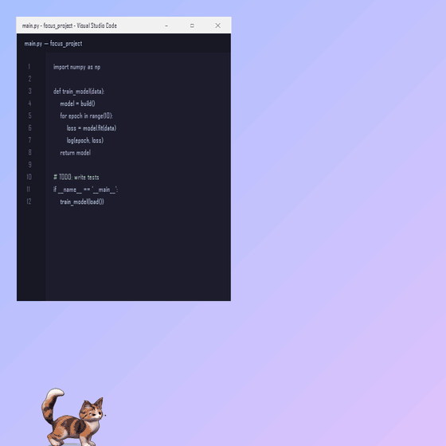
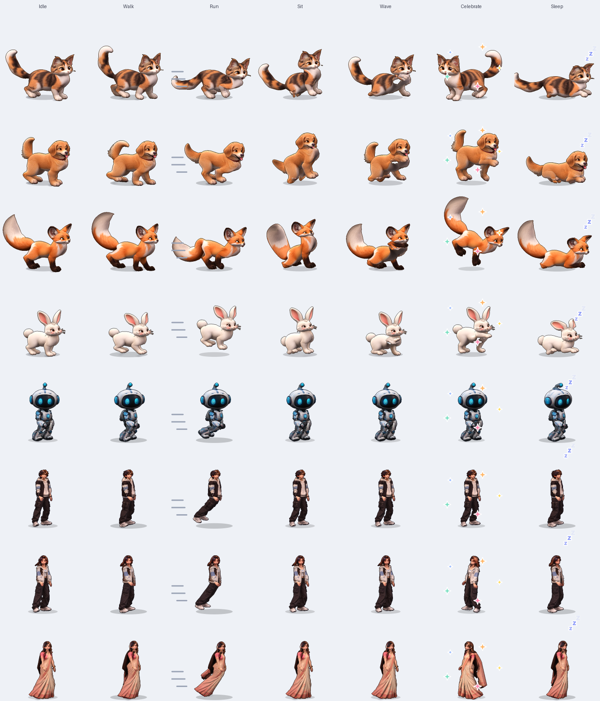
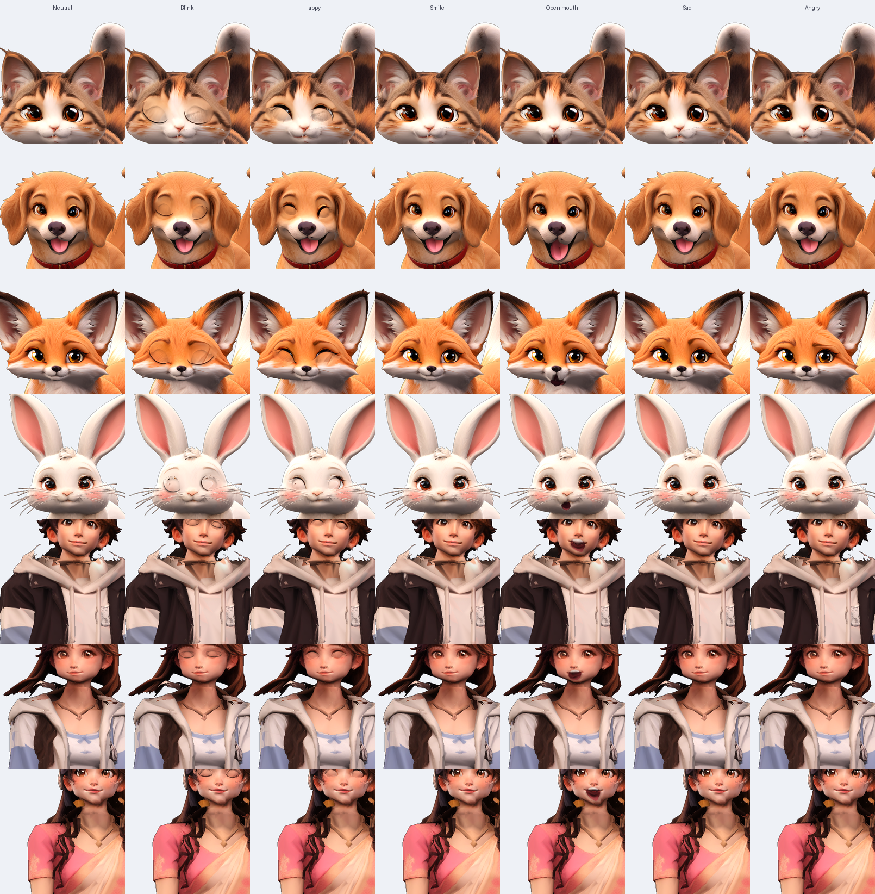

# FocusBuddy — Technical reference

> Full design and engineering notes. For the overview, see the [main README](../README.md).

A friendly desktop companion (a cat, dog, fox, rabbit, robot, or one of three study buddies) lives on your Windows desktop. It wanders around and naps. When you drift onto a distracting site or app, it notices, walks over to that window and helps you get back to work. It can close the distraction, but only when you allow it.



**The eight companions as rigged 3D models made from their character art** (default look - see
*3D companions*; the flat sheet art is still available as the *Illustrated* look):



**The app** - a bright *Sunset Pop* design (violet into watermelon pink, sunshine highlights) with fluid motion (page transitions, a gliding navigation pill, count-ups, ripples):


| Home (light) | Home (dark) |
|---|---|
|  |  |

| Log in (once per device) | Sign up |
|---|---|
|  |  |

| Profile chooser (profiles without an account) | Locked (PIN) | Account settings |
|---|---|---|
|  |  |  |

| Companions | Setup wizard |
|---|---|
|  |  |

| **3D characters**: walk / jog / run / sprint with planted feet | **Emotion pack**: angry stomp, "HEY!", scared, cry, love, dizzy, tantrum, sulk… |
|---|---|
|  |  |

| **Body language**: emotions read from the body and eyes alone — every icon, particle and text switched off (production renderer, built-in CC0 characters) | **Character showcase** (`--character-showcase`): walk → … → celebrate |
|---|---|
|  |  |

| **Character sheet** (runtime renderer): views, close-up, walking, core emotions for the six built-in characters | **Emotion showcase** (`--emotion-showcase`): 22 emotions on the cat, body + decal eyes, no icons |
|---|---|
|  |  |

| **Action showcase**: walk → run → jump → land → sit → sleep → wake → stretch → wave → dance → angry → shout → scared → celebrate (the fox: its own clips + the procedural rig) | **Gaits**: walk → jog → run → sprint → stop |
|---|---|
|  |  |

| **Final validation run** (`python main.py --showcase`, simulated desktop): cat sleeps → ear twitch → wake → yawn → stretch → stand → walk → looks at / follows the cursor → curious → pounce → land → shake → groom → sit → sleep; YouTube opens → wakes → alert → walk / run → arrives → warning → countdown → the tab is closed through the extension → celebrate → roams | **Body-language sheet**: 12 emotions × 8 characters, every effect off |
|---|---|
| [docs/final_validation.mp4](final_validation.mp4) |  |

| **Pose library**: 12 named full-body stands | **GLB characters**: views and LODs (built-ins and the two reference GLBs) |
|---|---|
|  |  |

| **Living character**: the validation sequence (sleep → wake → yawn → stretch → … → play → rest) on every character | **Parametric faces**: 22 emotions composed from smile / mouth / lids / pupils / brows |
|---|---|
|  |  |

| 3D showcase on the (demo) desktop | 2D skeletal animation | Continuous 2D showcase |
|---|---|---|
|  |  |  |

| Animation engine (gen 1 states) | Pressing the close button | Companion Playground |
|---|---|---|
|  |  |  |

| Dashboard | Statistics | Characters |
|---|---|---|
|  |  |  |

---

## Contents

1. [What's new in 2.3](#whats-new-in-23)
1. [What's new in 2.2](#whats-new-in-22)
1. [What's new in 2.1](#whats-new-in-21)
1. [What's new in 2.0](#whats-new-in-20)
1. [Project overview](#project-overview)
2. [Features](#features)
3. [Architecture](#architecture)
4. [Technology stack](#technology-stack)
5. [Installation](#installation)
6. [Running the application](#running-the-application)
7. [Configuration](#configuration)
8. [Character system](#character-system)
   - [Character assets (GLB pipeline)](#character-assets-glb-pipeline)
9. [Distraction detection](#distraction-detection)
10. [Browser integration](#browser-integration)
11. [Database](#database)
12. [Privacy](#privacy)
13. [Testing](#testing)
14. [Troubleshooting](#troubleshooting)
15. [Development roadmap](#development-roadmap)

---

## Project overview

FocusBuddy has two parts:

- **The virtual companion.** It is a transparent, always-on-top overlay with a state-driven, procedurally animated character. The character walks, runs, sits, sleeps, stretches and plays. It looks at your cursor and reacts to clicks and drags. When a distraction shows up, it moves to the distracting window.
- **The focus engine.** It monitors the active window, scores distraction from 0 to 100, and responds in stages: notice → warning → intervention → optional automatic block. It also runs Pomodoro-style focus and break sessions and keeps local statistics.

The guiding principle is that FocusBuddy should be *helpful, playful and slightly alive, never controlling*. It says "Hey… I think we wandered off task. Want to get back to it?", not "STOP WASTING TIME".

## What's new in 2.3

**Natural faces for the people** (Study Buddy, Study Girl, Saree Girl). Seen up close, the
generated faces looked pasted on. 2.3 rebuilds them from the shipped models
(`tools/refine/faces.py`, results in `refine.npz` and `face/painted.npz`; before / after:
[`v23_faces.png`](v23_faces.png)):

- *Chin and jaw* - the lower face was about a third too long and ended in a sloping wedge. The
  chin moves up toward the mouth and is rounded a little; the jaw underside runs back to the neck
  almost level; the top of the neck comes forward under it. The facial skin is lightly smoothed
  (Taubin smoothing, so the nose and lips keep their size). The same change is carried to every
  level of detail.
- *A jaw that follows the head* - the head had been joined to the body with the skin blend squeezed
  into the jaw underside, so every head turn sheared it flat. The jaw now follows the head bone
  completely; the neck bends gradually from Head to Neck to Chest along its length.
- *One seamless face image* - the face was cut into dozens of small texture islands, and each edge
  showed as a faint seam or patch. The front of the head is now re-baked into one continuous
  picture in an unused corner of the texture. Gradient-domain seam removal, then removal of the
  hair-coloured smudges the generator left on the cheeks. Pale patches are evened out toward the
  face's own skin tone, and an edge-preserving smooth is applied that leaves the eyes, brows, lips
  and nostrils sharp (those are gently sharpened instead). A soft blush finishes it. Toward the
  edge of the image the retouch fades out, so it meets the rest of the head without a step.
- *Skin shading* - bare skin (face, ears, neck, arms, hands) uses the "skin" response: soft wrapped
  light with a warm glow where it turns from the light, instead of cloth. The jaw also gets a
  little of its own shadow underneath. CPU raster and GPU shader are the same.
- *Blinks and mouths* - a person's eye now closes with skin continued from around the eye (no hair
  or painted eye-liner smeared into the lid). The old painted eye outline fades as the lid shuts,
  and there is a soft crease above the lash line. A resting smile no longer lifts the lower lids;
  a real laugh still does. The open mouth parts along the lip line found in the face image (it
  follows the smile), with soft edges, a hint of upper teeth and the tongue low. The eye-flattening
  morph is switched off for the people (`morph_map` in their `metadata.json`), because it creased
  the new lids.

Turn it off per character with `"refined_face": false` in `metadata.json` (the reshaped jaw and
the skin shading stay). Rebuild after changing a person's model:
`python -m tools.refine.faces buddy && python -m tools.refine.bake_ao buddy`. The tool keeps the
original face data as `face/painted_v22.npz` and always starts from it.

Known limits: a closed eye can still show a faint ring where the painted liner was, the collar
of the hoodie / blouse keeps its generated jagged edge, and the original high-detail head files
(`art/source_glb/*_head.glb`) were not used - the faces were refined from the meshes and textures
that ship. Verified on Linux only (CPU path offscreen, GPU shader on llvmpipe under Xvfb).

## What's new in 2.2

**The same companions, refined - never replaced.** Every model keeps its shape, colours and
personality; 2.2 only adds what makes them read as solid, living things. Before / after:
[`v22_before_after.png`](v22_before_after.png), close-ups:
[`v22_closeups.png`](v22_closeups.png).

- *Baked ambient occlusion* (`tools/refine/bake_ao.py`): per-vertex occlusion for every level of
  detail of all eight companions (`assets/characters/<id>/refine.npz`, 20-110 KB each), applied at
  load. It is normalised so open surfaces keep their exact colour - only creases, armpits, the gap
  under the chin and between the legs get darker. `"ao_strength"` in `metadata.json` tunes it
  (0 switches it off). Re-bake after changing a model: `python -m tools.refine.bake_ao cat dog`.
- *Softer studio light*, identical on the CPU raster and the GPU shader: a gentler
  ambient / key / fill balance, a warm rim light mixed with the surface colour, and a light
  S-curve grade.
- *Outlines that belong to the surface*: a deep shade of the neighbouring colour (a ginger cat gets a
  deep ginger edge) instead of one flat brown line.
- *Living eyes*: the painted eyes get a catchlight from the key light (the same spot in both eyes,
  like real reflections), a faint second reflection and a soft upper-lid shadow. A blink still
  covers them.
- *Clean hair edges*: pin-holes between alpha-masked hair strands are closed before the silhouette
  is traced, so hair no longer gets a dark ring around every gap.

**Lifelike motion.**

- *Poke reflexes*: a click hits a part of the companion - head, body or tail, from the pixels on
  screen - and gets an immediate physical flinch (the head pulls back, the ears flatten, a poked tail
  whips), applied after the smoothing stage so it stays snappy. A poked tail gets a startled look
  back over the shoulder; a tap on the head often reads as a pat (a happy squint and a slow blink or
  a nod). Your click-reaction setting still decides everything else.
- *Natural blinks*: the lids snap shut in about a third of the blink and open more slowly, with an
  occasional lazy half blink.
- *Breathing*: a short inhale, a longer exhale and a small pause; every breath is a little
  different in pace and depth, and now and then, while calm, a slow deep breath.

**A more modern, more interactive app.**

- *Command palette* (Ctrl+K, Ctrl+P, or just start typing in the search box): every action
  (focus, deep work, breaks, pause / resume, end, monitoring, hide / show the companion, theme,
  lock, switch profile), every companion, page, setting and help topic. Fuzzy matching ("st25" finds
  "Start 25-minute focus"), keyboard and mouse, the last few commands first. It fades and slides in
  over a soft scrim. 
- *Quick actions* on Home: one-click Focus, Deep work 50, Break 5, Pause / Resume monitoring, Add a
  task and All commands.
- *Drag to reorder*: hover a Home section and drag it by the small tab on its top edge. The order is
  remembered (locally, like every other setting).
- *A pokeable live companion* in the Home banner: its eyes and head follow your cursor, and a click
  pokes it - the same flinch as on the desktop, a little reaction and a few floating hearts or
  sparkles. 
- *Glass cards* get a soft accent spotlight that follows the cursor (full motion only; "reduced"
  and "off" motion settings turn it off with the other effects).

**Tests.** The suite was restored from an older archive and brought up to date with 2.x behaviour;
2.2 adds `tests/test_v22_lifelike.py` (occlusion bake and load, catchlights, hair closing, poke
reflexes, blink shape, breathing variety, the hit test, the live preview) and palette / Home
tests in `tests/test_premium_ui.py`.

Not verified yet: like 2.1, everything was run on Linux - offscreen Qt for the CPU path and Mesa's
software OpenGL (llvmpipe under Xvfb) for the GPU shader. Real Windows desktops and real graphics
drivers have not been tested.

## What's new in 2.1

**Animal motion, rebuilt from the feet up.** Three problems made the cat, dog, fox and rabbit look
broken on the desktop, and all three are fixed:

- *Skating paws.* The companion window moved on every timer tick, but the 3D picture was
  re-rendered less often (a slow frame or a busy UI thread), so between frames the old picture slid
  along with the window. Each frame is now rendered off-screen first, then the window moves and
  shows it in one step (`CompanionWindow.present`).
- *The "seal" walk.* The production models' feet followed a second ground lock that drifted from
  the rig's planted feet a little every step, until the hind feet trailed behind and the body sank.
  The model's feet now follow the rig's own planted feet (which never slide), with the hip offset
  frozen while a paw is down.
- *Floating, stiff legs.* Walk speeds and strides now give natural cadences (about 2 steps a second
  at a walk), a reach guard lets the stance leg bend enough to carry its step, limbs ease in and out
  (two-stage smoothing) instead of snapping, a raised paw no longer flickers between legs, a tail can
  no longer flip through the body (nor be laid on the floor in front of a sitting animal), paws peel
  off and set down without skidding, a hopping rabbit's paws clear the ground, running animals stream
  their tails out behind, and the cat sits upright on its haunches.

**Naps off-screen.** "Take a nap" (tray, the companion's menu, the dashboard's close question,
the wind-down) makes the companion yawn, stretch and walk off the nearest screen edge to sleep out
of sight. "Wake up" brings it back from the same side, still a little sleepy. It also naps while
you're away from the PC (Settings → Routines) and can keep a nap schedule.

**Companion care** (`intel/care.py`, the Care page): food, fun and love that drift slowly while
FocusBuddy runs (never below a floor, never while it's closed); treats earned by focusing (one per
10 minutes); feed / play / pet with matching reactions (a new EAT action, fetch, pounce, purr ...);
bond levels with titles and unlocks; badges for streaks and milestones.

**Routines and focus extras** (`intel/routines.py`): a morning check-in, an evening wind-down,
session goals ("Did you finish …?" at the end, a treat if you did), ambient focus sounds generated on
this PC (`utils/ambient.py`: rain, café, brown / pink noise, forest, fireplace - looped through
Windows `waveOut`), and Deep focus (a quiet companion, no chatter and distractions closed, for that
session only).

Not verified yet: the window/frame fix and the ambient sound player run on Windows only and were
tested offscreen on Linux, not on a real Windows desktop.

## What's new in 2.0

2.0 upgrades 1.2 in place: your settings, history and companion carry over (the database gains a
few tables and one column on first start). 1.2 is kept as the `v1.2.0` git tag.

**Smarter, all on this PC** (`focusbuddy/intel/`):

- **Focus coach** (`coach.py`): hour-of-day profile from your own history (focus vs distraction per
  hour, last four weeks), your best two-hour window, your riskiest hours, how sessions end, a week-on-
  week trend and how fast you come back from a distraction. The Coach page shows the heat map and
  insights; at the start of a risky hour the companion offers a session (Settings → Smart assistant).
- **Context engine** (`context.py`): notices *flow* (25+ min of steady work), *restlessness* (lots of
  window hopping), *marathons* (90 min without a pause), *late nights*, a *quick return* from a
  distraction, focus *milestones*, a *streak at risk* in the evening and a *slump*. Each moment sets a
  mood the companion carries for a while and some are remembered for the chat and the report. It
  uses only what FocusBuddy already sees (front app / site, idle time, the timer, the clock) - never
  keystrokes.
- **Tasks**: a task list with estimates, priorities and projects; start a focus session *on* a task
  and its time is credited to it.
- **Reports**: today and this week - focus score, sessions, tasks done, time per task, top
  distractions, the companion's memories of the day - and an optional evening summary bubble.
- **Chat** (`assistant.py`): the companion understands app commands itself ("start a 45 minute focus
  on the essay", "add task: read chapter 3", "what's on my list?", "how did I do today?", "when do I
  focus best?", "pause monitoring", "I can't focus") and does them. If **Ollama** runs on this PC,
  free conversation goes to it with a one-line summary of the day; the client refuses any address
  that isn't this computer. Without Ollama the built-in replies are used.

**More alive companions** (`companion/expression.py` and friends):

- **Talking faces**: when a bubble appears the jaw and mouth move per syllable of the actual words,
  pause at commas and full stops, the head nods on stressed words and the brows lift at the end of a
  question.
- **Micro-expressions**: eye micro-saccades, an eyebrow flash when attention jumps, small smiles that
  come and go in a good mood, a squint while thinking or reading, a slow head drift, and sighs (breath
  in, shoulders up, then a long breath out and a slump) when bored, sad, lonely or sleepy.
  "Lifelike detail" (Off / Low / Normal / High) in Settings → Advanced animation scales all of it.
- **Captured bodies breathe** and take the look chain's chest twist; nods and head drift also play
  on top of sitting postures.
- **New reactions** for every character: sneeze, hiccups, shiver, daydream and humming - with
  gags, lines and sounds. Pets tilt their heads and flick one ear at a time.
- **Three new CMU motion-capture clips**: a calm standing idle (137_28), a stretch with a big yawn
  (141_13) and impatient waiting (141_20, used for bored / impatient).

**Faster**: the software (CPU) renderer's depth test and texture sampling were rewritten
(scatter-max z-buffer, float32 gathers) with pixel-identical output; on this Linux test machine a
frame of the cat went from about 28.5 ms to 24 ms. GPU frame times were not measured (no GPU here).

## Features

| Area | What you get |
|---|---|
| 3D companions | **The eight companions as textured, rigged 3D models** (default look): cat, golden-retriever dog, fox, rabbit, Study Buddy, Study Girl and Saree Girl generated from their character art with Hunyuan3D and rigged by `tools/rig` (a skeleton checked per character, Blender bone-heat skin weights with per-character clean-up, three levels of detail); the white robot reconstructed from its sheet with TripoSR. **Faces that react**: the eyelids blink, squint and close, the mouth opens, brows and mouth corners follow the emotion. Animated by the procedural rig (walk / run / sit / sleep / wave / emotions / look-at / tail and ears). See *3D companions*. |
| Daily life | **A tiny, cheeky creature with its own day** (`companion/life.py`): wakes up curled at the screen edge and enters with a species entrance (cat peeks and climbs in, dog trots, rabbit hops, fox sneaks, robot descends and boots, humans walk in and wave), wanders and gets up to mischief from a catalogue of ~35 antics with rules, priorities and cooldowns, leaves for a while and comes back another way, asks before napping, turns the dashboard's X into a little scene (nap / stay / quit) and waves goodbye before quitting. A study partner during focus sessions, quiet when you ask, out of the way for full-screen apps, and it remembers you between launches (locally). See *Daily life*. |
| Illustrated characters | **Eight companions drawn from their character sheets** (optional flat look): cat, golden-retriever dog, fox, rabbit, white robot, Study Buddy, Study Girl and Saree Girl - 30-36 poses each (turnaround views, actions, emotional body language), animated by the same brain, emotions and locomotion as the 3D models. See *Illustrated characters* below. |
| 3D characters | All six original characters as **shaded 3D models** (toon lighting, specular highlights, rim light, outlines, real depth): they turn around in 3D, show their back when they sulk, and their faces (eyes, brows, mouths, tears, blush) are projected onto the 3D head. Driven by the same skeleton, IK and actions as the 2D art, so everything below works in both styles. GPU (OpenGL via Qt) when available, otherwise a vectorised NumPy renderer; switch in Settings → Companion → Character style. |
| Production characters | **GLB / glTF characters** with PBR textures (base colour, normal, metallic-roughness, occlusion, emissive), **GPU skinning** (CPU fallback), **skeletal clips** with crossfades, layers, masks and root motion, IK after animation (feet stay on the ground), morph-target faces, eye bones, contact shadows. Drop a character folder in, validate it, and it appears in the selector. Built-ins: the eight companions (above). Artist rigs (`head_scale` for a cuter head, sitting with straight front legs, clips) are covered by the reference GLBs (Khronos glTF Fox, RobotExpressive) and the former built-in Quaternius wolf, which stay loadable for tests and the studio but are hidden from the pickers. |
| Emotion pack | 25 emotions (adds ANGRY, GRUMPY, SCARED, EMBARRASSED, LOVE, BORED, SMUG, DISGUSTED, SHOCKED, LAUGHING, DETERMINED, DIZZY, RELIEVED, PROUD) and 19 new actions: ANGRY stomp (steam, anger vein, gritted teeth, dust), SHOUT (wind-up → lunge → cartoon "HEY!" bubble + sound), GRUMPY (arms crossed / turns away), TANTRUM, SULK (turns its back, peeks over the shoulder), SCARED (jump back + shiver), CRY (tears, rain cloud), EMBARRASSED (hides its face), LOVE (heart eyes), LAUGH (belly shake, "ha ha"), BORED (sigh), SMUG, DISGUSTED, SHOCKED ("!!"), DIZZY (spiral eyes, orbiting stars), DETERMINED (headband, fist pump), RELIEVED, PROUD, HUFF. They react to real moments: woken by a click → grumpy; poked 4× → angry stomp (then laughs); shaken while dragged → dizzy; a cursor whooshing past → a rabbit gets scared; ignoring a warning again → grumpy; countdown → "HEY!"; refused extra time → grumpy head shake; nobody around → bored; petting → love; back to work → relieved. Anger is playful cartoon grumpiness, never harsh — and *Grumpy reactions* can be switched off (gentle head shakes instead). |
| Companion | 6 characters with their own personality *profiles* (speeds, gait, energy, curiosity, sleepiness, idle habits, celebration) and dialogue. **Data-driven 2D skeletons with two-bone IK**: feet and paws stay planted on the ground while the body moves over them (foot-phase system CONTACT → LIFT → SWING → REACH). Four locomotion levels — **WALK, JOG, RUN, SPRINT** — each with its own gait (lateral-sequence walk FL→BR→FR→BL, trot, gallop with a flight phase, short sprint bursts), stride, lean, bounce and energy cost. Anticipation (crouch before jumps, lean back before sprints), follow-through, spring physics (tail chain, ears, head, hair, collar tag, robot antenna), tasteful squash & stretch, breathing, weight shifting and micro-movements as independent layers. A **library of 85 actions** (generic + cat / dog / fox / rabbit / robot / study-buddy specific, with species substitution) that combine in layers (e.g. WALK + LOOK_AROUND + EAR_TWITCH + TAIL_SWING), with priorities, cooldowns, exit points and blending. A brain with **energy (0–100), time of day, focus / break / distraction context** and rare surprise moments. Physical jumps with gravity, a ground shadow, subtle particles (dust, landing puffs, confetti, robot sparks) and footsteps synced to real foot contacts. 30 animation states. Delta-time locomotion with acceleration, braking, momentum and animated turns. Leaps onto window title bars, rides along when a window moves, falls when it closes. Emotions (11), attention (eyes and head track the mouse, windows, you), spring-based secondary motion, randomised blinking. Weighted idle life: walk, look around, sit, nap → wake → stretch, yawn, groom, scratch, play, peek over screen edges, read, watch you. Occasional trips to other monitors. |
| Interaction | Click: configurable reaction (wave / jump / spin / look). Double-click: dashboard. Right-click: menu. Drag: it dangles, then falls onto a window or the taskbar. Petting: rub the cursor back and forth. Mouse modes: ignore / look / follow / chase / run away. **You decide the size**: Small / Medium / Large / Extra large presets, a slider (0.6×–3×), or **Ctrl + mouse wheel over the companion**; the change animates smoothly. Click-through, opacity, frame rate. |
| Detection | Active app plus the **exact website** (through the browser extension), with a title-based fallback. Configurable website and app rules: Focus/Allowed, Distracting, Blocked, plus Auto-close. Scoring uses dwell time, revisits, app switching, focus mode, daily allowance and smart context (for example, YouTube tutorials count as less distracting). |
| Response | Level 1 Notice (head turns, eyes track the window, alert face) → Level 2 Warning: walks, accelerates, runs the last stretch, leaps onto the window, looks at it, looks at you, then asks (*Return to Focus / Give Me 2 Minutes / Ignore Once*) → Level 3 Intervention (*Close It / Keep It Open / Give Me 2 Minutes*) → Level 4 countdown standing by the X button (*Keep Open / Close Now / Give Me 5 Minutes*). **Extra time (snooze / ignore / keep open) is allowed once per site per session** by default; after that only *Return to Focus* and *Close* are offered. Level 4 runs in focus sessions (see *Focus sessions close distractions* below) or when you enable automatic blocking. |
| Blocking | The companion walks to the window's **close button and presses it with its paw** (wind-up, thrust, click ripple); the safe close runs at the moment of contact. Closes a tab through the extension, or swaps it for a "Back to focus" page. Minimizes a window, or politely closes an app with `WM_CLOSE`, which still lets the app ask you to save. Protected system apps are never touched. |
| Focus sessions close distractions | During a focus session **any** distracting or blocked site or app is closed for you after a short countdown with *Keep Open* (default *Close them for me*), or never loads at all (*Block instantly*: the extension shows a "Not during focus time" page). Scores also rise twice as fast in focus. You can set it to behave like the rest of the day instead. Closing is verified: the extension must confirm the tab closed; otherwise FocusBuddy sends Ctrl+W to the verified browser window, then minimizes it; apps get a polite close and are minimized if they ignore it. |
| Focus | 25/45/60/90/custom sessions, pause and resume, breaks and long breaks, auto-start, a halfway cheer, and a celebration at the end. Blocking relaxes during breaks. |
| App design | **Bright, cheerful look ("Sunset Pop")**: a warm cream canvas (midnight plum at night) with soft colour glows, frosted glass cards with soft shadows that lift on hover and a faint wash of their colour, a vivid gradient banner on Home and the information pages, gradient pill buttons with press ripples, and a floating sidebar whose selected item is a glowing violet-to-pink pill that glides between items. Page transitions rise and fade, numbers count up, rings and charts grow in. Light / dark (or follow Windows) and five accent presets, each with its own gradient partner (Sunset Pop, Mango, Lagoon, Ocean, Berry) or the Windows accent - **switched live**, nothing restarts. *Motion* setting (Full / Reduced / Off; Windows' "Animation effects" switch reduces it). The canvas is painted once per size and theme, and the animated companion previews keep their share of the UI thread small, so the dashboard stays smooth. Real-app details: search box for pages and settings (Ctrl+K), keyboard shortcuts (Ctrl+1-9 pages, Ctrl+H hide / show the companion, Ctrl+L lock, Ctrl+, settings, F1 Help), account menu, remembered window size, a title bar tinted to the canvas on Windows 11. |
| Account log-in | **An app-style log-in, once per device**: e-mail + password with *Log in* / *Sign up* tabs, show / hide password, *Keep me signed in*, inline errors and a busy state, a brand panel with the companions orbiting. With *Keep me signed in* FocusBuddy opens straight to your companion next time; it asks again only after *Sign out*. The account is stored on this device only (salted PBKDF2 hash, a random session token; nothing is sent anywhere), so there is no e-mail reset - a profile with a PIN can choose a new password after entering its PIN. Profiles from before accounts are asked once to add an e-mail and password; their data stays where it is. |
| Profiles & sign-in | **Local profiles with an optional PIN**: a sign-in screen with a clock ("Who's focusing today?"), each profile with its own history, rules, settings and companion; avatars from the companions' portraits; PIN set / change / remove, ask for the PIN at start, lock now (Ctrl+L, tray) or automatically after N minutes away, switch profile / sign out, delete a profile. Wrong PINs back off (5 tries, then a growing wait). Data stays on this PC; the PIN locks the window, it does not encrypt files. |
| Dashboard | Pages: Home, Focus, Statistics (four charts), History (search and CSV export), Sites & Apps, Companion, Playground, Settings, and the information pages **Privacy** (what is kept, what never is, export / delete), **Help** (getting started, playing with the companion, shortcuts, troubleshooting), **FAQ** and **About** (what's new, credits and licences). Opening FocusBuddy (the shortcut, the .exe or a second launch) always shows the dashboard **full screen (maximized)**, and the companion strolls onto the desktop a moment later; only a start with Windows waits quietly in the tray. The app moves: cards glide up into place on every page, the Home banner has drifting bubbles and sparkles, the sign-in screen fills the screen with its orbiting companions. A setup wizard runs on first start and **walks you through installing the browser extension**, waiting until it connects. |
| System | Tray icon and menu, rate-limited notifications, procedural sound effects with volume control, a "Start with Windows" option, a single-instance guard and structured logs. |

## Architecture

```
FocusBuddy/
├── main.py                     entry point (args, single instance, crash guard)
├── focusbuddy/
│   ├── app.py                  controller - wires everything, implements the intervention "view"
│   ├── demo.py                 scripted demo with simulated windows (any OS)
│   ├── config.py               paths + default settings
│   ├── core/
│   │   ├── activity.py         Activity snapshot
│   │   ├── monitor.py          ActivityMonitor: foreground window -> Activity
│   │   ├── rules.py            RuleSet (sites/apps, categories, auto-close)
│   │   ├── detector.py         DistractionDetector interface + RuleBasedDetector (0-100 score)
│   │   ├── classifier.py       ContextClassifier hook (keyword context, feedback learner)
│   │   ├── intervention.py     InterventionEngine: escalation levels, overrides, countdown
│   │   ├── focus_manager.py    FocusTimer (focus / pause / break)
│   │   ├── stats.py            StatsTracker (activity time, recovered time, sessions)
│   │   ├── whitelist.py        temporary "give me N minutes" allow-list
│   │   └── messages.py         MessageManager (dialogue JSON per personality)
│   ├── companion/
│   │   ├── rig.py              data-driven skeletons (bones, limbs, tail), FK layout, two-bone IK with joint limits
│   │   ├── gait.py             foot-phase system + gait tables (walk/jog/run/sprint, hop, mechanical, biped)
│   │   ├── actions.py          action library (85 actions), priorities, ActionPlayer (layers, blending, cooldowns)
│   │   ├── brain.py            ActionSelector (weights x energy x context x time of day), EnergyModel, surprises
│   │   ├── particles.py        tiny optional particle effects (dust, puffs, confetti, sparks)
│   │   ├── render3d.py         3D renderer: ellipsoid models on the rig, toon shading, outlines, face decals (CPU)
│   │   ├── render3d_gl.py      GPU backend: OpenGL impostor ray-casting through Qt (falls back to CPU)
│   │   ├── character.py        Companion: the single 60 FPS loop, sub-pixel placement, input, sounds
│   │   ├── behavior.py         brain: CharacterStateMachine + plans, idle life, chase, press, roaming
│   │   ├── states.py           CompanionState enum + validated transition table
│   │   ├── movement.py         LocomotionController: dt physics, accel/brake, turns, leaps, gait phase
│   │   ├── animation.py        AnimationController: gait cycles, emotion layer, springs, blinking, blending
│   │   ├── emotion.py          EmotionController (11 emotions, cross-faded styles)
│   │   ├── attention.py        AttentionController (prioritised look targets)
│   │   ├── pathing.py          PathPlanner (obstacle detours, leaps between surfaces)
│   │   ├── roaming.py          RoamingController (destinations, cooldowns, monitors)
│   │   ├── profile.py          CharacterProfile per character (speeds, gait, personality weights)
│   │   ├── renderer.py         procedural vector renderers (quadruped / biped)
│   │   ├── sprites.py          sprite-pack override (PNG frames / sheets)
│   │   ├── characters.py       character registry, looks, names
│   │   ├── overlay.py          transparent CompanionWindow + animated BubbleWindow
│   │   └── debug.py            animation debug overlay
│   ├── blocking/
│   │   ├── safety.py           SafetyGuard - protected apps, opt-in rules
│   │   ├── blocker.py          picks the safest action and executes it
│   │   ├── browser.py          tab actions through the extension
│   │   └── application.py      minimize / WM_CLOSE with re-verification
│   ├── browser/
│   │   ├── bridge.py           127.0.0.1 HTTP bridge <-> extension
│   │   └── title_parser.py     fallback: site from window title
│   ├── platform/
│   │   ├── base.py             WindowManager / AutostartManager interfaces
│   │   ├── windows.py          Win32 backend (pure ctypes)
│   │   ├── geometry.py         physical px -> Qt logical px (per-monitor DPI)
│   │   └── simulated.py        in-memory backend for tests & demo
│   ├── storage/                SQLite database + typed settings
│   ├── ui/                     dashboard, settings pages, wizard, tray, charts, theme, studio.py, playground.py
│   └── utils/                  logging, sound, clock, single-instance
├── browser_extension/          Manifest V3 extension (Chrome / Edge / Firefox)
├── assets/                     dialogue JSON, icons, optional sounds & sprite packs
├── tests/                      pytest suite (+ Node harness for the extension)
└── tools/                      screenshots, contact sheet, icon + sprite exporters
```

**Data flow (every poll, about once a second):**

```
WindowManager ─► ActivityMonitor ─► RuleBasedDetector ─► InterventionEngine ─► Companion (walk/run, bubble)
      ▲               ▲  (BrowserBridge ◄─ extension)            │  ▲ user buttons
      │               │                                          ▼  │
      └──── Blocker (SafetyGuard) ◄───────────────────── close / minimize / redirect
                                   StatsTracker ──► SQLite ──► Dashboard
```

The platform-specific code sits behind `WindowManager` and `AutostartManager`. `BrowserBridge` plays the role of the BrowserManager, `Blocker`/`ApplicationBlocker` the role of the ApplicationManager, and the Qt tray handles notifications. A macOS or Linux backend only needs to implement `platform/base.py`.

## Technology stack

- **Python 3.10+** and **PySide6 (Qt 6)**. Qt gives true per-pixel transparent frameless windows, a system tray, notifications, per-monitor DPI and multi-monitor geometry, and OpenGL for the 3D renderer.
- **NumPy** for the 3D renderer (CPU rasteriser, GPU vertex packing). Runtime dependencies: PySide6-Essentials + NumPy; without NumPy the app falls back to the 2D art.
- **Win32 through `ctypes`**: `GetForegroundWindow`, `QueryFullProcessImageNameW`, `DwmGetWindowAttribute`, `MonitorFromWindow`, `ShowWindow`, `PostMessageW(WM_CLOSE)` and `GetLastInputInfo`. There is no pywin32, no hooks and no keylogger.
- **SQLite** (standard library) for local storage.
- A **Manifest V3 browser extension** in plain JavaScript.
- **winsound** plays procedurally synthesised WAV effects (no audio files ship with the app).

## Installation

Requirements: Windows 10 or 11, and Python 3.10–3.13 from python.org (tick *Add python.exe to PATH*).

```bat
cd FocusBuddy
python -m venv .venv
.venv\Scripts\activate
pip install -r requirements.txt
python main.py
```

Or just double-click **`run.bat`**. The first run creates the virtual environment for you.

### Install as a Windows app (recommended)

On the PC (Windows 10 / 11, Python 3.11–3.13 installed once for the build):

```bat
build_installer.bat
```

It creates a virtual environment, runs the tests, builds `FocusBuddy.exe` with PyInstaller, runs the
built app's self-test and compiles **`installer\Output\FocusBuddy-Setup-1.0.0.exe`** with Inno Setup 6
(installed with `winget` if it is missing). Double-click the setup file:

- installs for your user only - no administrator rights - into `%LOCALAPPDATA%\Programs\FocusBuddy`
- adds FocusBuddy to the Start menu, optionally a desktop shortcut and "start when I sign in"
- appears in *Settings > Apps > Installed apps* with a normal uninstaller; uninstalling asks whether to
  keep your profiles and history (`%LOCALAPPDATA%\FocusBuddy`)

The setup and the exe are not code-signed, so Windows SmartScreen may say "Windows protected your PC"
the first time: click **More info > Run anyway**. Then install the browser extension (see *Browser
integration*; *Settings > Browser integration > Open extension folder* shows the folder to load).

### Build a standalone .exe (optional)

```bat
build_windows.bat
```

This runs the tests and then PyInstaller. The result is `dist\FocusBuddy\FocusBuddy.exe`, which you can copy anywhere; the target PC doesn't need Python. A GitHub Actions workflow (`.github/workflows/windows.yml`) does the same on `windows-latest` and uploads the exe and the extension zip as artifacts.

## Running the application

| Command | What it does |
|---|---|
| `python main.py` | Normal start (the setup wizard appears on first run) |
| `python main.py --minimized` | Starts in the tray (used by *Start with Windows*) |
| `python main.py --demo` | **Safe scripted demo**: fake editor and browser windows show the whole flow without touching your real apps |
| `python main.py --wizard` | Runs the setup wizard again |
| `python main.py --debug` | Verbose logs |
| `python main.py --studio` | **Animation Studio**: preview every animation/emotion at 0.25x–2x |
| `python main.py --playground` | **Companion Playground**: searchable action browser, emotional sequences, sequencer (loop / reverse / speed / delay / blend time), emotion mixer, orbit camera (drag / wheel / Front · Side · Back · 3/4 · Reset), debug toggles (skeleton, bone names, IK targets, foot contacts, root, velocity, attention, emotion values, mood, energy, current / next action) and a performance panel (also a Dashboard page) |
| `python main.py --character-showcase [--character cat]` | **Character showcase**: one character performs WALK → JOG → RUN → SPRINT → TURN → JUMP → LAND → SIT → SLEEP → WAKE → STRETCH → WAVE → PLAY → LAUGH → ANGRY → SHOUT → SCARED → SAD → HAPPY → LOVE → BORED → CELEBRATE with camera cuts (side, three-quarter, front, close-up, full body), then the next character (toggle *Cycle all characters*; renderer and *Effects* switches at the top) |
| `python main.py --emotion-showcase [--character robot_expressive]` | **Emotion showcase**: neutral, happy, curious, surprised, confused, sleepy, sad, lonely, angry, grumpy, scared, nervous, love, playful, confident, smug, focused, relaxed, grateful, jealous, impatient, excited — body and face, effects off, camera cuts |
| `python main.py --self-test [--self-test-report out.json]` | Loads, validates and renders every character offscreen, prints a JSON report, exits 0 / 1 (CI runs it against the built exe) |
| `python main.py --body-language-test [--character cat]` | **Body-language test**: NEUTRAL → HAPPY → ANGRY → SAD → SCARED → EXCITED → SLEEPY with every icon, particle, speech bubble and text switched off — the emotion has to read from the body |
| `python main.py --showcase` | **Standalone showcase** on simulated windows (nothing on your desktop is touched): SLEEP → WAKE → YAWN → STRETCH → STAND → LOOK AROUND → WALK → JOG → RUN → SPRINT → TURN → JUMP → LAND → SHAKE → SIT → LOOK AT CURSOR → CURSOR MOVES → EYES TRACK → HEAD FOLLOWS → CURIOUS → PLAY → REST, then YouTube opens: notice → head turn → eyes track → alert → walk / jog / run / sprint → arrive → stop → look at the window → look at you → SHOUT / warning → countdown → the X is pressed (safe window API) → relief → happy → jump → spin → celebrate → roaming |

**Try the core flow on your real browser:**

1. Install the browser extension (see [Browser integration](#browser-integration)).
2. Right-click the companion → *Start Focus Session* → 25 minutes.
3. Open youtube.com and stay there. Within a minute or two the companion notices, then walks over and asks.
4. To see automatic blocking, open Settings → Blocking mode → *Automatic blocking*. The countdown appears on sites marked **Auto-close** (YouTube, Instagram and TikTok by default). Choose *Keep Open* to cancel, or let it close the tab.
5. Switch back to VS Code or Word. The companion celebrates and the Statistics page updates.
6. Choose *Give Me 2 Minutes* once, stay on YouTube past the snooze: the second warning no longer offers extra time.

Tip: set *Detection sensitivity* to **Strict** and *Time between escalation steps* to 10 s to see the escalation faster.

## Configuration

Everything is in the dashboard (double-click the companion, or use tray → *Open Dashboard*):

- **Account**: the account's e-mail, sign out, profile name and avatar, PIN (set / change / remove), ask for the PIN at start (off unless you turn it on), lock automatically when away, lock now, switch profile, delete this profile.
- **General**: your name (optional), start with Windows, start quietly with Windows (in the tray - opening FocusBuddy yourself always shows the dashboard), notifications.
- **Appearance**: app theme (*Use system setting* (default) / Light / Dark), accent colour (Sunset Pop / Mango / Lagoon / Ocean / Berry / Windows accent colour) and motion (Full / Reduced / Off) - all applied instantly.
- **Monitoring**: on/off, sensitivity (relaxed/balanced/strict), minimum distraction duration, daily distraction allowance, away-after time, smart context, title fallback, treat games as distracting (any exe under a Steam / Epic / GOG / Riot / Xbox games folder).
- **During focus sessions**: *Close them for me* (default) / *Block instantly* / *Same as the rest of the day*, and how much faster scores rise in focus (2× by default).
- **Score thresholds**: mild (40), warning (70) and strong (90) by default.
- **Blocking (outside focus sessions)**: mode (*Warnings only / Ask before blocking (default) / Automatic blocking*), grace-period countdown, escalation spacing, website action (close tab / focus page / minimize), close tabs with the browser's Ctrl+W when the extension isn't there (on by default), app action (close (default) / minimize), terminal protection, snooze lengths.
- **Sites & Apps**: allowed, distracting and blocked websites and applications, each with an **Auto-close** switch. Domain rules match subdomains, the most specific rule wins (for example, `music.youtube.com` stays allowed), and a rule can include a path (`youtube.com/shorts`). App rules accept wildcards (`game*.exe`). Search the list, filter it by category (with counts), click a rule's category chip to change it and its switch to allow auto-close; edits apply at once and keep your place in the list (scrolling never changes a category by accident).
- **Focus**: default duration, break, long break, auto-start, relaxing blocking during breaks, daily goal.
- **Blocking → Extra time**: once per site per session (default), once per session (any site), unlimited, or never.
- **Companion**: character, name, size (small / medium / large / extra large / **Giant: about a quarter of the screen's height** / custom 0.6×–5×, animated; Ctrl + wheel over the companion), show the companion on the desktop (a hidden companion comes back from Home, here, the tray or Ctrl+H), personality (mix a character's body with another's behaviour), movement speed, animation intensity, idle behaviour, walking frequency, roaming (taskbar only / windows & edges / all monitors), mouse cursor mode, click reaction, celebration style, petting, edge peeking, stay close during focus, opacity, frame rate (30/60/120), always on top, click-through, speech bubbles, sound level (off/low/medium/high), footsteps.
- **Companion → Appearance**: *Renderer* (**3D models** — the eight companions as skinned GLB characters, default; **Illustrated** — the flat character-sheet art; **3D Procedural** — the ellipsoid models; **2D Fallback** — flat vector art; each falls back to the next if it can't run), *Character style* and *3D quality* (Low = 1x; Normal = 2x super-sampling; High = 3x with a soft shadow; Ultra = 4x. With a GPU, Normal and above re-render at up to 60 FPS, Low at 30; the CPU fallback re-renders at 20–30 FPS and lowers super-sampling automatically for big companions so the frame time stays level. The window itself always moves at the full frame rate, and quality steps down by itself if frames keep missing their budget).
- **Companion → Daily life**: *Playfulness* (80 %), *Roaming frequency* (60 %), *Unsolicited dialogue* (70 %: small talk every few minutes - cheers, compliments, fun facts, stretch and water reminders after long work, a welcome back after a break, a time-of-day greeting), *During focus sessions* (Strict: only essential warnings / Balanced: occasional silent reactions, default / Playful: more reactions between tasks), *Where it spends time* (edges and corners / mostly edges, default / the whole desktop), *Leave and come back*, *Quiet mode*, *Closing the dashboard* (the companion asks, default / just hide / nap), *Wake-up scene at start*, *Step aside for full-screen apps*.
- **Companion → Advanced animation**: *Emotion intensity* (Low / Normal / High) and *Grumpy reactions* (on by default; off = gentle head shakes instead of stomping and "HEY!").
- **Companion → Advanced animation** (Low / Normal / High, Normal by default): animation smoothness, movement smoothness, secondary motion, physics strength, idle activity, character energy; particles, time-of-day behaviour, surprise moments.
- **Companion → Developer**: animation debug overlay, skeleton drawing (bones / IK targets / foot contacts), Animation Studio, Companion Playground.

## Character system

One coordinated loop per frame (a single precise `QTimer`; Windows timer resolution raised to 1 ms while running so 60 FPS doesn't stutter). The brain decides *what* the character wants to do, the animation system decides *how* it physically performs it, the renderer decides how it looks:

```
                     Character Brain (behavior.py + brain.py)
              ┌──────────────┼──────────────┐
         Personality      Context        Emotion      (+ energy, time of day, cooldowns)
              └──────────────┼──────────────┘
                     Action Selector  ──►  plan steps / ActionPlayer (priorities, exit points)
                             ▼
                 LocomotionController (dt physics, gait levels, jumps)
                             ▼
       AnimationController layers: base state → actions (full / upper) → locomotion → emotion
                 → attention → breathing / weight shift / micro-movements / additive actions
                 → secondary springs → blending (per-field easing)
                             ▼
       Rig: layout → foot-phase system (planted feet) → pose overrides → two-bone IK → RigPose
                             ▼
               Renderer (limbs from IK, tail chain, shadow) + particles → overlay window
```

### Daily life

The companion is a little digital pet with a routine, moods, curiosity and memory - lively when
you aren't busy, disciplined when you focus. `focusbuddy/companion/life.py` sits on top of the
body (`Behavior`: locomotion, actions, emotions, the distraction choreography):

- **Life states** with a validated transition table (`LifeMachine`): SLEEPING -> WAKING -> ENTERING
  -> ROAMING <-> INTERACTING / PLAYING / RESTING -> EXITING -> AWAY -> ENTERING ..., plus FOCUSING,
  DISTRACTION_WARNING, DRAGGED_BY_USER and GOODBYE. Invalid jumps are refused and logged; a
  distraction warning cancels whatever the companion is doing first (no teleporting, never two
  scenes at once).
- **Scenes**: the wake-up (curled up in a corner -> wakes -> species flourish: the cat stretches
  and shakes its paws, the dog wags, the rabbit's ears twitch, the fox peeks cautiously, the robot
  boots up, the humans stretch, fix their hair and wave -> yawn -> notices you -> walks in), species
  entrances and exits, leaving for a while (it walks off-screen and returns minutes later with a
  different entrance), naps (asks first when its energy is low; quiet mode just naps), and the
  goodbye.
- **The dashboard's X never quits FocusBuddy.** It hides the dashboard, and the companion stops,
  turns to you and asks *"Wait, we're done already? Should I go curl up for a nap?"* - **Go nap**
  (it curls up in a corner and sleeps; FocusBuddy keeps running in the tray; a click or *Wake up*
  wakes it), **Stay here** (an excited hop) or **Quit FocusBuddy** (it waves, walks off, then the
  process exits). *Quit FocusBuddy* in the tray / right-click menu plays the same goodbye (at most
  a few seconds). Unanswered questions time out quietly.
- **Antics** (`GagEngine`): each has an eligibility rule, a priority, a step sequence, a
  cooldown, interruptibility, emotions and lines. The troublemaker (peeks around a window,
  pretends to walk away and turns back, gets caught staring at the cursor and looks away, forgets
  why it came, pokes a bubble until it pops, does something silly then looks innocent), the
  attention seeker (follows the cursor, waves and waits - ignored, it pretends to be offended, then
  gets over it - brings an imaginary gift / toy / book), the commentator (short remarks, a focus
  challenge, a smug "called it" when the same distraction comes back, streak and milestone
  cheers), the study partner (reads / works beside you, quiet nods, "stuck?" with a hint or break
  after a long pause, sleepy in very long sessions) and species signatures (cat slow blinks, tail
  flicks, sudden sprints, pretending not to hear you; dog trots, fetch, happy hops; rabbit freezes,
  sniffs, hops; fox feints, sneaks, sideways glances; robot scans, glitch dances, charging naps;
  humans check a watch, read, work on a laptop; the Saree Girl twirls and claps). The choice
  weighs mood, energy, personality settings, cooldowns, a no-repeat memory and a learned
  affinity; the Playground's *Daily life* panel shows why each antic was chosen and what was
  skipped.
- **Focus first**: during a session it settles near you; *Strict* allows only essential
  warnings, *Balanced* only silent study-partner moments, *Playful* more reactions between tasks.
  After about 90 minutes of continuous work outside a session it offers a break. It never makes
  surprise sounds, never steals keyboard focus, and hides while a full-screen app or presentation
  is in front.
- **Memory** (local only, the SQLite settings table): last state, mood and energy (a night apart
  means well rested), last entrance / exit, favourite and recent antics and lines, focus sessions
  and milestones, interactions and ignored waves. A companion you play with seeks the cursor a
  little more; one that's often ignored wanders off a little more - subtle, and drifting back to
  neutral over time (no guilt trips).

### 3D companions (default look)

Every companion is a **3D model made from its own character art** - the cat, dog, fox, rabbit,
robot, Study Buddy, Study Girl and Saree Girl the sheets show, not stock models.


**The models.** The cat, dog, fox, rabbit, Study Buddy, Study Girl and Saree Girl were generated by
the project owner with **Hunyuan3D** (Tencent's image-to-3D generator) from the character art: one
textured mesh each (about 50 k triangles, a 4096² colour texture). The robot is the earlier
reconstruction of its sheet with TripoSR (`tools/reconstruct_3d.py` + `tools/build_3d_companions.py`,
unchanged). The generated source models live outside the repository (`art/source_glb/`,
git-ignored; about 250 MB).

**The rig** (`tools/rig/`, see its docstrings; run `python tools/rig/make.py cat dog ...`):

1. `blender_prep.py` (Blender's `bpy` module) welds and triangulates the source and writes its
   mesh, texture coordinates and texture.
2. **Skeleton** (`skeleton.py`): FocusBuddy's canonical bones placed from landmarks read off
   labelled grid renders of each model (front / side / back / top, `grid.py`) and refined to the
   middle of the mesh's cross-sections; the animals' facing from their paws; ears from the head's
   highest points, the tail as a chain along it. Generated animals often turn their head: it is
   straightened before rigging (a mirror-symmetry fit of the face, then a skinned rotation of the
   head - no torn edges).
3. **Skin weights** (`weights.py`): Blender's bone-heat weights, then per-character clean-up -
   ears only follow the head, upper legs never take the belly, the people's long hair (by its
   colour) only the head and chest, a saree follows the hips and both thighs toward its hem, arms
   are kept off the torso they touch - smoothed over the surface, four influences per vertex.
4. **Face rig** (`face.py` + `focusbuddy/companion/face_paint.py`): the eyes and mouth are painted
   in the texture, so a separate eyelid mesh would always look stuck on. Instead the build fits an
   ellipse to each painted eye and stores, for every texel of the eyes and the mouth, its place on
   the eye / mouth and what a closed lid shows there (the fur or skin around the eye, continued
   over it: a membrane between the surrounding colours plus the fur detail from above the eye -
   Poisson blending, so the lid has no seam). At run time the renderer re-draws those texels in
   its own copy of the texture: the **upper lid** comes down with a lash line and a soft shadow, a
   **happy squint** rises from below in a "^^" arch, the **mouth** opens as a dark oval with a
   tongue. The **blink** also flattens the sculpted eyeball and socket (a morph target with its
   own normals, so the shading closes too), and **brows, mouth corners and the jaw** are morph
   targets driven by the emotion. Only texels the eye surface owns are painted (measured along the
   surface, so a strand of hair in front of an eye is never painted as the eye).
5. **The people's heads** (`head_swap.py`): the full-body models spent very few triangles and
   texels on the faces, so each person's head was generated a second time from a head-and-shoulders
   close-up of the character art (`art/source_glb/<id>_head.glb`, about 500 k triangles, a 4096²
   texture of the face alone). The build puts that head on the rigged body: the new head is
   straightened (the art draws the girls with a tilted head), scaled so its eyes and mouth span
   the old ones and placed eye on eye. The two necks are **welded** (`weld.py`): just under the new
   jaw, where the new head's neck is still a clean tube, both necks are measured with rays, bent
   toward each other (each moves part of the way, fading out along the neck), cut by two close
   planes and stitched with a short band, so the neck is one continuous surface. The body's neck
   takes the new skin tone at the seam (an offset that keeps its detail), the band's texture runs
   from the head's colours to the body's, angle by angle. The old head comes off (the neck above
   the cut, the old hair, chin and jaw; the hood lining and collar are cut straight under the new
   jaw); the old hair behind the neck narrows into the new head and ends inside it, so long hair
   still falls from under the new hair. The new head drops its generated hood, headphones, straps
   and collar pieces; its own long hair stays. Its texture becomes a tile under the body's atlas;
   its weights are the body's neck weights at the join, blending into the Head bone over the jaw.
   The skeleton, the body and every animation are unchanged; the
   lower levels of detail keep about 45 % of their triangles for the head, and the seam's vertices
   stay put on every level (no crack). The face rig is fitted
   to the new, big drawn eyes (round lids, a "^^" squint). Without a `_head.glb`, the older face
   tile (`face_tile.py` + `beauty.py`: the old face re-rendered sharper and retouched) is used.
6. **Export** (`export.py`, `lod.py`): one GLB per level of detail - the full model for the High /
   Ultra quality, 20 k and 9 k triangles (decimated in Blender, the weights and morphs carried over
   by the closest surface point) for Normal and Low - plus `metadata.json`, `LICENSE.md` and
   `face/painted.npz`.

**Real motion capture for the people and the robot (1.2).** Study Girl, Saree Girl, Study
Buddy and the robot move with clips cut from the CMU Graphics Lab Motion Capture Database
(mocap.cs.cmu.edu): three standing idles, walk / jog / run, waves (with the arm nearer the viewer,
either way the companion faces), a big two-handed wave, stretch-and-yawn, a flourished bow,
celebrate, dance, laugh, cry, scared, angry and a shrug; a jump whose crouch, flight and landing
are timed by the physics (any height fits); sitting down on the floor, sitting (legs out, leaning
back on the hands) and standing up again; lying down, sleeping stretched out on the back and
getting up. `tools/mocap/build_library.py` cuts the trials listed in `tools/mocap/clips.py`
(resampled to 30 fps, turned to face forward, travel removed, cycles closed seamlessly, lying clips
centred on the body) into one small skeleton-independent library, `assets/mocap/library.npz`;
`focusbuddy/companion/mocap.py` retargets it onto each model when it loads (each bone is first
turned from the model's bind direction onto the capture skeleton's, then follows the captured
rotation; the hips follow at the model's own leg length). The clips play through the
`ClipAnimator`: phase-synced locomotion, crossfades, posture transitions that always play through
(sit down -> sit -> stand up, lie down -> sleep -> get up, sitting -> lying joins mid-clip), gestures
layered over the posture (only the arms while sitting), foot IK and look-at on top. Gestures
without a capture (clap, point, thumbs-up, beckon, fist pump) are reached by IK from the captured
shoulders. Metadata per model: `"mocap": true` or `{"walk": "walk_lady", "leg_damp": 0.55,
"arm_out": 16}` (Saree Girl takes the graceful narrow-stepping walk; the robot holds its short arms
a little out). **The saree** (`"skirt"` metadata) is re-weighted at load so the cloth below the hips
follows the legs - left / right by side, blended across the middle, thigh to shin below the knee,
the long hair down her back following both legs equally - so she can sit on the floor and lie down
without the drape crumpling, and her steps are narrowed so the hem stays together.


The pets have **no baked clips**: the procedural rig animates them through `RigDriver`
(retargeting by bone directions, two-bone leg IK, look-at, ear and tail springs, body-language
posture). For models with their own proportions (`"pelvis_lift": "auto"`) the driver stands them
at their own hip height, carries the rig's foot and hand offsets over to their own hips and
shoulders (strides scaled to their legs), keeps planted feet fixed and flat on the ground with a
travel odometer, lowers the body when a leg can't reach the ground, bends a tail up off the floor
instead of lifting the body, keeps arms low unless waving or cheering, and bends a long torso
further for a sad slump.
On the generated models the four-legged companions **sit on their haunches** (the rump drops, the
spine pitches up until the front legs stand straight) and **stretch with a play bow** (chest down,
front paws reaching forward); the people and the robot **gesture clearly in the 3/4 view** - a
pointing arm out to the side, hands meeting in front of the chest to clap, a thumbs-up, a
"come here" beckon, a fist pump, a real wave beside the head - and a happy bounce with open arms.
The robot's hands, which the image-to-3D model had skinned to its hips (a raised arm pulled
strings out of the body), are bound to its hands at load (metadata `hand_zone`).



Limits, plainly:

- These are **generated** models with an **automatic** rig and per-character corrections, not
  hand-modelled, hand-rigged or hand-painted assets. Their look follows the generator, not the
  character sheets exactly (the cat came out a calico, the rabbit cream-white without its collar).
- The surface is the generator's: the back and the hidden sides are its guess, and fine detail
  lives in the texture, not the geometry. The people's heads are a second generation welded at the
  neck: the join is continuous, but its colours are matched automatically, so very close up a faint
  change of tone can show; Buddy's hood lining keeps a few jagged edges beside the jaw; the saree
  girl's head texture has a lilac shadow on one cheek (the generator's). Their style follows the
  head generation (big anime eyes), a little different from the body's.
- Big motions still stretch skin where the generator joined limbs to the body: the fox's chest
  by its front leg when walking, the saree's drape when the arm waves. The saree is skinned, not
  simulated: in a walk a fold of the hem can swing out behind for a moment.
- The motion capture is real human movement retargeted onto stylised bodies: hands come close to
  but are not solved against the body (a hand can graze a hip), the robot's short arms and big head
  make its waves smaller, and the sitting / lying clips come from one performer (a slow, careful
  sit-down). The people sit on the floor - there is no chair on the desktop.
- **Pets**: they leap for real now (push off nose-up with the hind legs trailing, gather the paws
  at the top, reach for the ground on the way down) and wave a front paw up at chin height.
- The painted lids and mouth look best from the front and 3/4; up close a closed lid can show a
  faint outline where it meets painted shadow or hair. Brows move the face's own surface, so
  they are subtle on the animals.
- About 7 MB per character (three levels of detail, JPEG textures). The CPU renderer draws a frame
  in about 28 ms at Normal quality in this environment; not measured on Windows or with a GPU.
- **Licence**: Hunyuan3D's output is used under the Tencent Hunyuan 3D Community License (and the
  terms of the site it was made on). It is not an open-source licence: among other things it does
  not cover use in the EU, the UK or South Korea, and large services need a separate licence -
  read it before any commercial use. Each character folder's `LICENSE.md` says so.

### Illustrated characters (optional flat look)

The eight companions are drawn from their **character sheets** (the art supplied for FocusBuddy:
turnaround views, facial expressions, full-body actions, emotional body language): Cat (Momo),
Dog (Biscuit), Fox (Ember), Rabbit (Mochi), Robot (Bolt), Study Buddy (Sam), **Study Girl (Mia)** and
**Saree Girl (Meera)**. `tools/build_illustrated_packs.py` cuts every pose out of its sheet
(per-pose background removal with ISNet + U2-Net, hole filling, edge colour un-mixing), puts all
poses on one scale and writes `assets/characters/<id>/illustrated/` (WebP frames + `pack.json`,
format in `focusbuddy/companion/illustrated.py`). The sheets are kept in `art/sheets/`.

The illustrated renderer is driven by the same brain, state machine, emotions and locomotion as
the 3D characters:

- every state picks its pose (sit, sleep, stretch, groom, read / laptop, wave, point, play bow,
  roll over, jump start / air / land, …) and calm states show the **body-language pose for the
  current emotion** (happy, curious, playful, confident, scared, angry, sad, excited, relaxed,
  sleepy, grumpy, love, attentive);
- walk and run are **pose cycles locked to the leg phase** (walk ↔ side view, run ↔ sprint);
- poses are mirrored to face the way the companion moves, the front view shows while turning or
  looking at you, the back view while sulking;
- cross-fades between poses, breathing, bob, lean, squash & stretch, jumps with a contact
  shadow, and the emotion marks (!, ?, zzz, hearts…) are layered on top procedurally.

Limits, plainly: these are 2D pictures, not rigged 3D models. The character cannot rotate
freely, walking and running use two poses each (no in-between frames), and the faces in the
*facial expressions* row are not swapped onto the bodies (the neutral face is used for the tray /
window icon). Choose it under Settings → Companion → Renderer → *Illustrated*.

### 3D renderer

- **Models**: every character is built from smooth 3D parts (rotated ellipsoids) placed on the solved skeleton: torso, belly, stripes, haunches, two-segment legs and paws (from IK), spring tail chain, neck, head, muzzle, nose, ears (pointy, floppy or long), collar + tag, robot visor / antenna / LED / ear bolts, the study buddy's hair cap, fringe and tuft. Limbs get a lateral depth (near / far side) so the z-buffer sorts them correctly.
- **Camera**: orthographic, 11° from above, 22° toward the viewer while walking; `Pose.turn` rotates the model through a front view when it turns around; `Pose.back` rotates it until its back faces you (sulking). The head turns toward you by default. Horizontal stretch compensation keeps planted feet planted on screen.
- **Shading**: toon key light + soft bounce + rim light + specular; emissive LEDs / robot eyes; silhouette and contour outlines (where a part sits > 2 units in front of another); 1x / 2x / 3x super-sampling.
- **Faces**: eyes, brows, mouths, cheeks / flush, tears, whiskers, headband are vector decals projected onto the head (foreshortened by the surface normal, hidden when the head turns away or a paw covers them, via an analytic depth test).
- **Backends**: `render3d_gl.py` draws each part as a screen-space quad whose fragment shader ray-casts the exact ellipsoid (true depth, same lighting), outlines as depth-biased hulls, renders off-screen and reads back a small image. If no OpenGL context can be created, `render3d.py` does the same on the CPU with NumPy (analytic ray/ellipsoid intersection, z-buffer, gathered shading, dilated outlines). Measured on Linux at the default size: ≈3 ms/frame with Mesa's *software* OpenGL (a real GPU is faster), ≈5–9 ms on the CPU path; 3D frames are re-rendered at 24–30 FPS by default while the window keeps moving at 60.

### Emotion pack

New emotions live in `emotion.py` (`EmotionStyle` gained `tremble`, `flush` and a persistent `mark`); new actions in `actions.py`; new eye styles (angry lids, half-lidded, shock, heart, spiral, cry / teary, squeeze ><), mouths (shout, laugh, gritted teeth, wobble, smirk, pout, tongue) and marks (anger vein, steam, gloom cloud, orbiting stars, sigh puff, !!, "ha ha", shout lines, battery) in `renderer.py` — shared by 2D and 3D. New rig channels (`cover`, `cross`, `belly`, `stomp`, `back`) put paws over the face, cross arms, hold the belly and stomp with IK. Contextual triggers are in `behavior.py` (`react_click`, `drop`, `_startle`, `emote`, `investigate(mood=…)`, `prepare_press(shout=…)`) and `app.py`; cue lines (SHOUT, POKED, WOKEN, DIZZY) in `assets/dialogue/*.json`; sounds (shout, stomp, sigh, love, dizzy, laugh) are synthesised.

### 3D character overhaul (production pipeline)

The overhaul upgrades the *character system underneath* rather than adding more face icons. Every
frame goes through one pipeline:

```
CHARACTER   CharacterAsset.load("cat", quality="high")   GLB / GLTF if installed, else procedural
    ▼
SKELETON    canonical bones (Root, Pelvis, Spine, Chest, Neck, Head, Jaw, ears, arms / front legs,
            legs, Tail0…) mapped from Mixamo / Blender / custom names (bone_map)
    ▼
POSE        rig solve: layout → foot-phase planting → body-language pose (lean, crouch, head,
            shoulders, fists, akimbo, hug, arms out, stance, tail) → two-bone IK (feet / hands, poles)
    ▼
ANIMATION   ActionPlayer layers by priority + optional GLB clips (retargeted, slerp-blended, masks)
    ▼
FACE        lids, lid tilt, lower lid, brows, pupils / eye direction + convergence, jaw, mouth shape,
            cheeks, ears — vector decals on the head, or the asset's own morph targets
    ▼
SECONDARY   springs: ears (per ear), tail chain, antenna, hair, tag; breathing; blinks
    ▼
PHYSICS     locomotion (accel / brake / gaits), jumps (small / normal / high), landing compression
    ▼
LIGHTING /  stylised materials (fur, cloth, skin, plastic, metal, eye, emissive): wrap + toon
MATERIAL    diffuse, sky/ground ambient, cool fill, rim, sheen, skin warmth, metal reflections
    ▼
RENDERING   skinning (LBS + morphs, NumPy) → rasterise (OpenGL, or vectorised CPU) → scale-aware
            outline → soft shadow → face decals → (optional) icons / particles
```

- **Renderer modes** (*Settings → Companion → Appearance → Renderer*, the Playground and the
  showcase): **3D Production** (`render_mesh.py`, skinned GLB characters) → **3D Procedural**
  (`render3d.py`, ellipsoid models) → **2D Fallback** (`renderer.py`). `make_renderer` and the
  running companion step down the chain on any failure (missing / broken asset, GL error, renderer
  exception), and the GPU path drops to the CPU rasteriser if the GL context is lost.
- **Assets** (`character_asset.py`, `gltf.py`): a dependency-free glTF 2.0 reader / writer (GLB and
  .gltf + external buffers, skins, morph targets, animations, materials, base-colour textures);
  LOD files (`model_low.glb`, `model_medium.glb`, `model.glb`, `model_ultra.glb`) with fallback
  order; animation files in `animations/`; a validator. See
  [Character assets](#character-assets-glb-pipeline).
- **Built-in characters are artist-made CC0 models** (see
  [Built-in characters](#built-in-characters-and-licences)). The earlier *procedurally sculpted
  demonstration assets* (`tools/build_demo_assets.py`: signed-distance primitives → marching cubes →
  automatic skin weights) are no longer shipped; two of them live in `tests/assets/` to keep the
  rig-driven path, LODs and decal faces under test.
- **Rig driver** (`skinning.py`): the asset's own bone lengths are kept; the pelvis is placed from
  the rig, spine / neck aim along the rig, pelvis roll and chest twist are added, the head copies the
  head frame (look-at chain + roll), ears / jaw / fists / tail are driven directly, and every limb is
  re-solved with 3D two-bone IK on the asset's bones toward the rig's foot / hand targets with the
  rig's knee / elbow as the pole. The result is that planted feet stay planted on the mesh too
  (tested: < 1.5 px of slide at 124 px for every character at walk and run).
- **Body language** (`emotion.py` `POSES` + `animation.py` `_body_language`): a pose library of 29
  named full-body stands (neutral, relaxed, alert, happy, angry, sad, scared, sleepy, confident,
  confused, bored, excited, curious, surprised, love, proud, determined, nervous, embarrassed,
  disgusted, grumpy, suspicious, impatient, lonely, playful, laughing, relieved, dizzy, focused).
  Each emotion maps to one (`EMOTION_POSE`), scaled by intensity and blended like the face. Each
  stand also sets breathing rate / depth and blink speed. With every icon off, angry = leaning in,
  low, wide stance, fists, fast deep breaths; sad = head down, shoulders dropped, tail down, slow
  breathing; scared = leaning back, crouched, arms hugging, tail tucked, fast shallow breaths.
- **Acting**: shout (inhale / puff → lunge → recoil → settle), cartoon anger (notice → GLARE →
  stomp / angry → short shout → HUFF → COOL_DOWN → neutral, never threatening), scared (startle →
  BACKPEDAL → hide face → tremble → peek → relief → cool down), fetch, plus new actions: GLARE,
  COOL_DOWN, NOTICE, DUCK, RECOVER, SKID_STOP, BACKPEDAL, SIDESTEP, SLOW_WALK, SMALL_JUMP,
  HIGH_JUMP, LISTEN, TAIL_WRAP, LOOK_BACK, CURL_UP, LOOK_AT_WATCH, CHECK_PHONE, FIST_PUMP,
  EXCITED_JUMP (149 actions in total, with aliases and species substitutes).
- **Priorities**: the spec's CRITICAL / SPECIAL / EMOTION / LOCOMOTION / IDLE / MICRO map to
  `CRITICAL_REACTION`, `SPECIAL_ACTION`, (`DISTRACTION_RESPONSE`, `CELEBRATION`, `INTERACTION`),
  `LOCOMOTION`, `IDLE`, `MICRO_MOVEMENT`. A rare stumble while walking plays STUMBLE (or FALL_OVER
  → RECOVER) and then resumes the same walk. A timed action in a plan ends with its plan step.
- **Desktop world**: the cursor approaching quickly → NOTICE (ears / eyes on it); circling the
  character → CURIOUS, then a dog spins and a cat / fox paws at it; a newly opened large window gets
  a glance; a window dragged at the character makes it hop aside. All of it is read-only window /
  cursor geometry — nothing is ever clicked, and closing still uses only the safe window APIs. The
  character looks away after a while (attention decay, per-personality `gaze_hold`), turns 3/4 to
  the viewer when idle and blinks on large gaze shifts. Focus mode keeps all of this quiet.
- **Personality & mood**: per-species traits (sociability, independence, nervousness, chaos,
  precision, gaze hold) scale action weights and startle odds; the mood model exposes a category
  (HAPPY, CALM, CURIOUS, BORED, ANNOYED, EXCITED, SLEEPY) that biases what it chooses. Memory is
  short-term and local (recent clicks, ignored warnings), never page contents.
- **Quality / LOD**: Low / Medium / High / Ultra select the matching LOD file and super-sampling.
  Measured on Linux at 124 px (single core, no GPU; GPU = Mesa llvmpipe software GL): low ≈ 9 ms
  CPU, medium ≈ 21 ms CPU / 18 ms GL, high ≈ 44 ms CPU / 31 ms GL per re-render. The window still
  moves at 60 FPS; 3D frames re-render at 24–30 FPS by default, adaptive quality steps down when a
  frame is slow. A real GPU should be much faster, but that was not measured.
- **Known limits**: Draco / meshopt / sparse accessors are not supported (the validator says so);
  no screen-space ambient occlusion; foreign clips (authored on another skeleton) are retargeted
  by rest-relative rotations plus the root's translation, which assumes similar bone axes.

### Built-in characters and licences

| Character | Model | Source | Licence |
|---|---|---|---|
| Cat, Dog, Fox, Rabbit, Study Buddy, Study Girl, Saree Girl | Generated from the character art with Hunyuan3D (one textured mesh each), rigged by `tools/rig` (skeleton, bone-heat weights, painted face rig, levels of detail), procedural animation | Hunyuan3D (generated by the project owner) + `tools/rig/`, from the project's own character art | Tencent Hunyuan 3D Community License (territory and scale limits - read before commercial use); the artwork belongs to the project owner |
| Robot | 3D reconstruction of its character sheet, baked colour texture, automatic skeleton / weights, procedural animation | `tools/reconstruct_3d.py` (TripoSR) + `tools/build_3d_companions.py`, from the project's own character art | TripoSR is MIT (Stability AI & Tripo AI); the artwork belongs to the project owner |

| Motion capture (Study Girl, Saree Girl, Study Buddy, robot) | Clips from the CMU Graphics Lab Motion Capture Database, BVH conversion by Bruce Hahne, retargeted at load | `assets/mocap/` built by `tools/mocap/` | Free for research and commercial use (CMU places no restrictions; the conversion adds none). Acknowledgement: "The data used in this project was obtained from mocap.cs.cmu.edu. The database was created with funding from NSF EIA-0196217." |

Each folder carries a `LICENSE.md`. The models replaced the earlier stand-ins (Quaternius wolf /
fox / RobotExpressive, KayKit Mage, and a cat and rabbit reshaped from the fox); the wolf stays in
`tests/assets/demo_wolf` for the tests of the clip-driven path, RobotExpressive and the Khronos
fox remain as hidden reference GLBs.

Pipeline features for artist rigs (exercised by the reference GLBs and the test wolf):

- **Leaf bone-map targets**: a `bone_map` entry may name a plain node below the skeleton
  (Blender `*_end` leaves). It becomes a weightless joint, so rigs whose IK targets sit outside
  the leg chain (Quaternius animals) get a real upper -> lower -> end chain for foot IK.
- **Stride-matched locomotion**: each locomotion clip's stride is measured at load (speed of the
  planted foot under the body x cycle length, or `clip_settings.<clip>.stride`), and the clip
  advances by the distance actually travelled, not one cycle per rig step.
- **Foot locking**: a foot the clip plants keeps its spot on the ground while the body moves over
  it (at the reach limit it slides along instead of popping).
- **Attached nodes**: `"attach": {"IKFrontLeg.L": "FrontLowerLeg.L_end", ...}` makes a node outside a
  limb chain (a paw driven by an IK target in the source rig) follow a chain joint rigidly, so IK,
  foot locks and procedural poses (sit, stretch, wave) never pull a paw off its leg.
- **Ground clamp**: nothing in a pose goes through the floor - if sitting / lying pushes part of the
  mesh below the ground line, the character is lifted onto it.
- **Neckless rigs**: a missing `Neck` (head straight on the chest, e.g. KayKit) is a validator
  warning, not an error.
- **Node-animated rigs** (rigid toy models without a skin) get a synthetic skin.
- `"tail_gain"` in metadata.json scales the emotion-driven tail angle (long tails need less).
- `"material_overrides"`: recolour or re-shade materials without editing the GLB
  (`{"*": {"shading": "fur"}, "Main": {"color": "#E3843F", "metallic": 0}}`).
- `"normals": "smooth"` (+ `"crease": 75`): soft welded normals for faceted low-poly models.
- `"stance_drop"`: a lower, crouched stance (fraction of the hip height); the leg IK bends the legs.
- `"head_scale"` (0.7–1.6, default 1): a stylised, cuter head - the head joint's subtree (ears, eyes,
  muzzle) is drawn this much bigger about the head joint in every pose; the decal face scales with it.
- `"face": {"mode": "decal", "eyes_from": "<eye material>", "eye_yaw": 49, "cheeks": false,
  "mouth_decal": false}`: decal eyes placed automatically over the model's own eyes.
- `"reference": true` keeps an asset loadable (studio, showcase, tests) but out of the pickers.

### Production assets and skeletal animation

This phase makes the 3D system ready for artist-made characters instead of adding more
procedural geometry. What exists now (audit before the work: [docs/3D_AUDIT.md](3D_AUDIT.md)):

| Character | 3D model | What it validates |
|---|---|---|
| All eight built-ins | **3D models made from the character art** (Hunyuan3D / TripoSR + automatic rig - see [3D companions](#3d-companions-default-look)) | the rig-driven path on textured, auto-skinned meshes: own proportions (`pelvis_lift`), planted feet with the travel odometer, body-language posture without clips |
| `demo_wolf` (tests only, `tests/assets/`) | **Artist-made GLB** (the former built-in Quaternius wolf, CC0) | clip-driven: 24 clips, stride-matched locomotion with foot locking, leaf-node IK chain ends, attached IK-node paws, `head_scale` |
| `demo_cat`, `demo_rabbit` (tests only, `tests/assets/`) | **Procedural Demo Character** (GLBs sculpted by `tools/build_demo_assets.py`, `production: false`) | the rig-driven path, LODs, decal faces |
| Fox (glTF sample) — `fox_sample` | **Artist-made GLB** (Khronos glTF sample "Fox": CC0 model by PixelMannen, CC-BY 4.0 rigging / animation by tomkranis, conversion by @AsoboStudio / @scurest) | base-colour texture, a real skeleton and skin weights, Survey / Walk / Run clips, root translation tracks, a mesh without normals |
| Robot (Quaternius) — `robot_expressive` | **Artist-made GLB** (Quaternius "RobotExpressive", CC0, morphs by Don McCurdy) | 14 clips (Idle, Walking, Running, Jump, Sitting, Wave, Dance, Yes, No ...), Angry / Surprised / Sad morph targets with a `weights` channel, rigid bone-parented parts, two skins, a 100x armature scale |
| `pipeline_test` (hidden) | **Generated test asset** (`tools/build_reference_asset.py`, not art) | all five PBR texture slots + tangents, ARKit-named morph targets, an Idle clip with a blink `weights` channel, a Walk clip with root translation (root motion), a Wave clip |

The two artist-made assets are low-poly samples, not bespoke FocusBuddy characters: they prove
that a real GLB drops in and works (selector, clips, textures, IK, faces) — they are not a claim
that FocusBuddy ships final production art. New characters only need files (see
[Character assets](#character-assets-glb-pipeline)).

- **Materials and textures** (`gltf.py`, `character_asset.py`, `pbr.py`): glTF metallic-roughness
  materials with per-pixel `baseColorTexture`, `normalTexture` (tangent space, scale),
  `metallicRoughnessTexture`, `occlusionTexture` (strength) and `emissiveTexture`
  (+ `KHR_materials_emissive_strength`), alpha mask, double-sided, `KHR_materials_unlit`,
  `KHR_texture_transform`. Textures can be embedded in the GLB, data URIs or relative files
  (PNG, JPEG, WebP / `EXT_texture_webp`), are decoded locally with Qt and never leave the
  machine; paths outside the asset folder are refused. Colour factors and `COLOR_0` are treated
  as linear (converted to display space). The shading is a stylised "polished toy" model: wrapped
  key light with a soft toon step, cool fill, sky / ground ambient × occlusion, rim, fur / cloth
  sheen, skin warmth, metal reflections, and a GGX highlight from metallic / roughness that is
  capped so characters never look wet. The same maths runs in NumPy (CPU) and GLSL (GPU).
- **Normals / winding**: missing normals are computed with welded positions (no seams at UV
  splits or in unindexed meshes) and a 70° crease angle (hard edges stay hard); tangents are
  computed when the file has none; mirrored nodes flip winding; primitives whose normals mostly
  disagree with their winding are flipped (inside-out exports).
- **Bind space**: skinned vertices are skinned into world space at the rest pose and bone-parented
  rigid meshes are placed by their node transforms, so both share one bind space (this is what
  makes FBX-converted models like the Quaternius robot work).
- **GPU skinning** (`render3d_gl.GLSkinRaster`): the mesh lives in static vertex buffers (sorted
  by material); per frame only the joint matrices (3 × vec4 per joint, up to 128 joints), the four
  strongest morph weights and the camera are sent; the vertex shader skins with 4 influences and
  applies morphs, the fragment shader samples the textures. Chain:
  **GPU skinning → CPU skinning (NumPy) → procedural 3D → 2D**. The Playground has a
  *Renderer: GPU Skinning / CPU Skinning* switch for side-by-side comparison; a test asserts the two
  produce the same silhouette (IoU > 0.985), colours and foot line.
- **Skeletal clips** (`clip_anim.py`): named clips (`idle`, `idle_01`, `idle_02`, `walk`, `walk_fast`,
  `jog`, `run`, `sprint`, `jump_start`, `jump_loop`, `jump_land`, `sit`, `stand`, `sleep`, `wake`,
  `wave`, `celebrate`, `angry`, `sad`, `scared`, `laugh` …) mapped in `metadata.json` or recognised by
  common file names (Idle, Walking, Running, Sitting, Dance …). The base layer blends the
  locomotion clips by gait level and **phase-syncs them to the rig's foot phase** (the cycle
  advances with distance travelled, so feet don't skate); idle variations rotate; state clips
  (sit, sleep, wake …) follow the behaviour state. Every change crossfades with per-transition
  blend times (`"transitions": {"idle->loco": 0.3, "default": 0.25}`) — never a hard switch.
  An action layer plays action clips (wave, celebrate …) full-body or masked to the upper body
  (walk + wave + happy face + look at the cursor at once). Actions that have no clip (stretch,
  groom, pounce …) are performed by the procedural rig, which takes over the body for their
  duration. Translation, rotation, scale and morph `weights` channels are read.
- **Root motion**: `"root_motion": "IN_PLACE" | "ROOT_MOTION" | "HYBRID"` (default HYBRID), per
  clip in `clip_settings`. HYBRID removes the clip's per-cycle drift and keeps its sway — the
  desktop movement system owns the world position; ROOT_MOTION reports the clip's horizontal
  travel each frame and the companion moves along the floor by that much (never off the
  surface); IN_PLACE pins the root.
- **Evaluation order**: base clips → crossfades → action layer → root / world placement (jumps,
  crouch, lean from the rig) → emotion offsets (spine slump, neck drop / reach, arm and paw
  poses via IK) → **IK** (feet / paws back onto the ground, planted feet stay planted) → look-at
  (neck 30 % / head 70 %) → secondary (tail, ears, jaw) → blend with the procedural pose where no
  clip plays → skinning.
- **Ground** (`ground.py`): `GroundSurface(kind, height, slope, extent)` — taskbar, window ledge,
  screen edge, platform, air; the IK asks it for the height under each foot.
- **Faces**: morph targets are mapped from ARKit / common names (`jawOpen`, `mouthSmile*`,
  `mouthFrown*`, `eyeBlinkLeft/Right`, `browDown*`, `browInnerUp`, `cheekPuff`, `eyeWide*`,
  `eyeSquint*`, `Angry`, `Sad`, `Surprised` …) or custom `"morphs": {"happy": "mouthSmile"}`;
  emotions drive them (happy, sad, angry, surprised, blinks, jaw). No morphs → the vector decal face
  (`"face": {"mode": "decal"}`) or none (`"mode": "none"` for textured faces). Eye bones
  (`LeftEye` / `RightEye`) follow the look target with convergence — eyes first, then the head
  and the torso (the existing attention chain).
- **Lighting**: soft key / fill / rim / ambient, soft drop shadow plus small **contact shadows** under
  the feet that touch the ground; occlusion maps darken ambient. (No screen-space AO.)
- **Presentation**: the settings page labels each character honestly ("Procedural Demo
  Character", "Artist-made GLB character") and shows asset licences; asset folders with a
  `metadata.json` appear in the character selector automatically.
- **Performance** — measured on Linux at 150 px with Mesa *llvmpipe* (software OpenGL, no GPU),
  GPU skinning, per frame (`step` = behaviour + animation, `paint` = rig + IK + skinning matrices +
  draw + read-back + decals):

  | Character | step | paint (before → after optimisation) | of which GL raster | of which Python |
  |---|---|---|---|---|
  | cat / dog / fox / rabbit (1.8–3.2 k tris) | 0.7 ms | 11.5 → 7.3 ms | 4.3 ms | 7.1 → 3.0 ms |
  | robot (3.2 k tris, morphs) | 0.7 ms | 9.3 → 7.3 ms | 5.6 ms | 3.8 → 1.7 ms |
  | study buddy (4.8 k tris, textured) | 0.7 ms | 13.2 → 9.5 ms | 7.3 ms | 5.5 → 2.3 ms |

  The optimisation pass: clip tracks are resampled once per clip on a 60 Hz grid (vectorised slerp)
  instead of being searched and interpolated per track per frame; clip FK runs level by level on
  all joints at once; subtree rotations, attached paws and the ground clamp are vectorised;
  rotation helpers and the eyelid tint use scalar math (NumPy's per-call overhead dominated on
  3-vectors); the procedural rig pose is skipped when a clip covers the whole skeleton. With
  software GL the rasteriser dominates; on a real GPU the draw is expected to be ~1 ms, leaving
  ~2–3 ms of Python — **not measured on GPU hardware**. Without OpenGL the CPU rasteriser starts at
  the medium tier (26–60 ms) and steps down to low (10–18 ms) when frames keep missing their budget.
  Repaints follow the state: ~30 FPS idle (24 on the CPU path), 12 FPS asleep, none while hidden.
  The Playground's performance panel shows FPS, frame time, CPU skinning, GPU render, IK / rig,
  animation and physics time, draw calls and the active clip.

### Living character upgrade

Extends the existing rig, renderer, emotion, action and behaviour systems (nothing was replaced):

- **Rig** (`rig.py`) — species-specific hierarchy: root → pelvis → spine → chest → neck → head → jaw / eyes / ears; quadruped back legs hang from the pelvis and front legs from the chest (hip → upper → lower → foot); biped arms hang from the chest (shoulder → upper arm → forearm → hand); the tail starts at the pelvis. **Constraints** (`CONSTRAINTS`, `apply_constraints`) clamp head pitch / yaw, neck, eyes, jaw (the robot has none), ears (rabbit ears droop further), spine, pelvis roll, torso twist and foot pitch, with NaN guards; knees / hocks / elbows keep their bend direction via the IK joint limits. **Feet** have their own pitch: flat while planted, heel lift and toe-down through the swing, toe up at heel strike (bipeds), stiff for the robot. **Named IK targets** (`left_foot_target`, `front_right_foot_target`, `right_hand_target` …) are reported on every solve and can be overridden (`Rig.solve(..., ik_targets={"right_hand_target": (x, y, weight)})`); `two_bone_ik_3d` bends toward a pole vector for limbs leaving the side plane.
- **Root motion** stays separate: the Mover moves the root, the foot-phase system plants the feet, IK compensates.
- **Walk weight** — the hips roll with each step, the chest counter-twists (shoulders against hips), the head counter-rolls to stay level, stride timing varies slightly; **braking** from speed leans back and sinks. **Species jump styles**: quick cat crouch with a long stretched leap, rabbit tight tuck with ears streaming back, enthusiastic dog with paws forward and a happy second bounce on landing, stiff robot with a slow mechanical wind-up and a clunky landing (sparks). **Landing** compresses the body, bends the legs, dips the head, snaps ears / tail / antenna and puffs dust.
- **Secondary motion** (`secondary.py`) — generic spring-damper bones driven by acceleration, vertical velocity, turn rate and tilt rate: tail, each ear separately, head, hair, hoodie hem, antenna, collar tag. Frame-rate independent (1/240 s sub-steps), limited, NaN-safe.
- **Faces** — continuous parameters (`smile`, `mouth_open`, `mouth_width`, `jaw`, `lid`, `lid_low` (cheek raise), `lid_tilt`, `pupil`, `brow_raise`, `slump`) composed per emotion, scaled by intensity 0–1, blended across emotions (`EmotionController.set_mix`) and drawn by both renderers; neutral parameters draw exactly the classic faces. **Look-at chain** (`attention.py`): eyes first, then head, neck and finally torso as the angle grows (all clamped); **eye convergence** on near targets.
- **Emotions** — 37 in total, new: surprised, confused, calming, confident, lonely, playful, jealous, impatient, relaxed, focused, nervous, grateful. Big changes of heart route through bridges (angry → relieved → happy → celebrating; scared → relieved → …).
- **Actions** — 130: high five, bow, greet, farewell, tumble, skip, stomp, hide face, tremble, panic, sigh, laugh hard, stumble, fall over (very rare), stagger, lean, peek behind, look over, head bump + purr (cat), lean to cursor, shout soft / big; **variants** (3 jumps, 3 turns, 3 celebrations, 2 laughs, 3 shout levels) picked by personality, mood and energy; spec cooldowns (jump 20 s, dance 90 s, sleep 5 min, stomp 60 s, shout 2 min, surprise 30 s). Explicit Playground / showcase requests aren't blocked by idle cooldowns.
- **Sequences** (`Behavior.perform_sequence`) — shout (3 levels, escalating with ignored warnings), angry (stomp → huff/steam → arms crossed → calm; robot LEDs turn red), scared (jump back → hide face → tremble → peek → relief), surprised, laughing (animals roll on their back, people hold their belly), crying, love (cat head bump + purr, dog wag + bounce, others lean in), boredom (bored → look around → sigh → lie down → doze), sulk (after repeated ignored warnings: huff, turn its back, peek … then forgive with a nod), dizzy with stagger. All cartoon — never threatening.
- **Mood** −100…+100 (`MoodModel`): petting +10, focus complete +20, you come back +10, ignored −5, repeated clicks −10, long inactivity −5; it drifts back and only *biases* choices (more play when happy, more sitting when low). **Short-term memory** (`ShortTermMemory`) remembers the last few minutes of interactions with the companion — in memory only, never written to disk, nothing about what you type or read.
- **Environment** — sits beside / leans on / peeks around the side of nearby windows, looks over the edge of the window it stands on, hops aside when a window is dragged at it, holds on when its window is yanked. It never clicks: closing still goes through the existing safe window APIs. **Cursor reactions**: off / subtle (default: eyes and head follow) / playful (a cat may pounce at a resting cursor).
- **Rendering** — quality tiers LOW (simple lighting, no shadow) / MEDIUM (= the old *normal*: lighting + shadow) / HIGH (3x supersampling, bolder outlines) / ULTRA (4x, glossier, soft double shadow); adaptive quality steps down if frames keep missing their budget; GPU → CPU → 2D fallback now also happens at runtime (a failing 3D frame switches the companion to 2D instead of crashing). Per-frame stats: total / build / raster / decal ms, primitives, draw calls.
- **Settings** (persisted): 3D quality, renderer, adaptive quality, shadow, animation smoothness, physics strength, emotion intensity, movement speed, character, personality, sound, particles, cursor reactions, window interactions, clumsy moments.


### Second-generation animation

- **Skeleton (`rig.py`)** — every character has a `SkeletonDef`: bones (`BoneDef(name, parent, length, rest, limits)`), limbs (`LimbDef(upper, lower, bend, width)`), a tail chain and proportions (the fox has longer legs, the rabbit short front legs, the robot stiff shins). Override any of it without code in `assets/characters/<id>/skeleton.json`, e.g. `{"legs": {"FL": {"upper": 10, "lower": 13}}, "tail": {"lengths": [9, 9, 9]}}`.
- **IK** — analytic two-bone IK (law of cosines) with joint limits: knees/hocks/elbows never bend backwards or fold flatter than their limit; unreachable targets give a straight limb pointing at the target. Used for feet, paws (wave, groom, scratch, press), and the study buddy's arms (point, clap, thumbs up, hand to chin, writing).
- **Foot planting (`gait.py`)** — each foot has its own phase: CONTACT → PLANTED (locked to the ground in odometer coordinates, so it stays exactly where it touched down) → LIFT → SWING → REACH. If a leg would over-stretch the foot lifts early instead of sliding. When the body stops, feet that aren't under their hips take a quick settling step, one at a time. Measured planted-foot drift at walk / jog / run / sprint: 0.000 units (tested).
- **Gaits** — WALK (lateral sequence FL→BR→FR→BL, duty 0.66, body vaults over the legs), JOG (trot, diagonal pairs), RUN (gallop: front pair, flight, hind pair; spine gathers and extends), SPRINT (short bursts, mostly for interventions), rabbit bound, mechanical robot gait (linear servo steps), biped walk/run with a flight phase. Levels blend continuously with speed. The intervention chase escalates walk → jog → run → sprint (limited to `profile.sprint_time`) → natural deceleration.
- **Actions (`actions.py`)** — generic (IDLE, STAND, WALK, JOG, RUN, SPRINT, STOP, TURN, SIT, LIE_DOWN, SLEEP, WAKE, STRETCH, YAWN, SCRATCH, GROOM, SHAKE, SNIFF, LOOK_AROUND, JUMP, HOP, BOUNCE, SPIN, DANCE, CHASE_CURSOR, PLAY, ROLL, PAW_AT_OBJECT, HAPPY, EXCITED, CURIOUS, SURPRISED, WORRIED, ANNOYED, SLEEPY, CONFUSED, PROUD, CELEBRATE, WAVE, LOOK_AT_USER, NOD, SHAKE_HEAD, POINT, BECKON, CHEER, CLAP, THUMBS_UP) plus species actions (cat LOAF, LICK_PAW, TAIL_SWISH, PAW_AT_CURSOR, POUNCE, ARCH_BACK, LOOK_UP; dog DOWN, TAIL_WAG, PLAY_BOW, PANT, PAW; fox EAR_TWITCH, QUIET_WALK, SNEAK, TAIL_SWING, ALERT; rabbit DOUBLE_HOP, NOSE_TWITCH, FREEZE; robot BOOT, SCAN, PROCESSING, HEAD_ROTATION, MECHANICAL_WALK/RUN, CHARGE, LOW_BATTERY, ERROR, RECALIBRATE, LASER_LOOK, SYSTEM_CHECK, SLEEP_MODE; buddy THINK, READ, WRITE). A cat asked to clap does a paw-patter, asked for a thumbs-up it nods; a robot asked to groom runs a system check.
- **Priorities & interruptions** — CRITICAL_REACTION > SPECIAL_ACTION > DISTRACTION_RESPONSE > CELEBRATION > INTERACTION > LOCOMOTION > IDLE > MICRO_MOVEMENT. A new plan waits for the playing action's next exit point (max 0.8 s) and never cuts a jump mid-air; interrupted actions blend out from where they are. A distraction never waits for a 12-second loaf to finish (tested).
- **Brain (`brain.py`)** — weights × personality × energy × context × time of day × cooldowns (jump 20 s, dance 90 s, nap 5 min …) × "don't repeat yourself". Focus sessions make it a quiet study partner; breaks make it playful; a distraction triggers NOTICE → head turn → eye track → ALERT → WALK → JOG → RUN → SPRINT → stop → look at the window → look at you → WARNING. Cursor "look" mode lets curiosity win now and then (a cat paws at a resting cursor, the robot laser-looks at it).
- **Events** — FOOT_CONTACT, JUMP_START, JUMP_LAND, ACTION_START, ACTION_END, BLINK, TAIL_SWING, CELEBRATION_PEAK, SPARKS drive footsteps (synced to real contacts), particles and sounds.
- **Performance** — still one QTimer, no per-bone timers, no threads, no screenshots. Measured on Linux (offscreen): ≈0.3 ms update + ≈1.3 ms paint per frame at default size; adaptive frame rate when idle.

- **State machine** (`states.py`): 30 states with an explicit transition table. A sleeping pet must wake (`WAKING`) before it can run; `CLOSING_DISTRACTION`/`PRESSING` only follow a distraction response. `path_to()` finds legal routes.
- **Locomotion** (`movement.py`): `position += velocity × dt` in fixed 1/240 s sub-steps, so travel time is identical at 60/120/144 Hz (tested). Ease-in acceleration, arrival braking, steering inertia. Reversing = brake → turn (animated, the body squashes through the flip while the head turns first) → accelerate. `walk_then_run` gait: starts walking, then runs the last distance. Ballistic leaps with crouch/take-off/landing events. The gait phase advances with *distance / stride length*, so feet don't slide and walk↔run blends with real speed.
- **Animation** (`animation.py`): walk = diagonal trot with knee lift, body bob, head stabilisation; run = rotary gallop with longer stride, spine flex, forward lean, ears/tail streaming back; hop gait for the rabbit, snappier mechanical gait for the robot, arm swing for bipeds. Springs give head lag, tail follow-through, ear flop, a settle wobble when stopping and landing squash. Every pose field eases with its own time constant (eyes fast, body slow) — nothing pops. Blinks are randomised per character, with double blinks and slow sleepy blinks.
- **Emotion** (`emotion.py`): HAPPY, NEUTRAL, CURIOUS, ALERT, SUSPICIOUS, EXCITED, SLEEPY, WORRIED, ANNOYED, CELEBRATING, SAD — each a style (ears, eye size/opening, brows, mouth, tail wag, bounce, blink rate, speed) cross-faded over 0.35 s and decaying back to the character's baseline.
- **Attention** (`attention.py`): DISTRACTION_WINDOW > USER_INTERACTION > NOTIFICATION > MOUSE > MOVEMENT_TARGET > ACTIVE_WINDOW (plus a scripted "look at you" beat). Eyes clamp; a target behind the body makes it turn around.
- **World, roaming, paths** (`behavior.py`, `roaming.py`, `pathing.py`): visible windows are surfaces. The companion can leap onto title bars, ride along when you drag the window, and fall when it closes or minimises. Roaming picks safe points, screen edges (peek over), window edges, near the cursor or the active window, and occasionally another monitor, with cooldowns and memory so it doesn't repeat itself. Open-space travel detours around blocking windows via corner waypoints.
- **Personality** (`profile.py`): `CharacterProfile(walk_speed, run_speed, acceleration, deceleration, turn_time, stride_walk/run, body_bob, run_lean, tail_swing, ear_response, head_lag, blink_interval, idle_frequency, curiosity, energy, sleepiness, playfulness, celebration, weights…)`. The cat sprints occasionally, grooms and naps; the dog runs, plays and watches you; the fox moves smoothly and stays alert; the rabbit hops with quick turns; the robot turns precisely and dances; the study buddy reads.
- **Pressing the close button**: the paw-tip position is defined by each renderer (`press_point()`); the brain computes where the feet must stand so the tip lands on the window's X (top-right caption button) and plays raise → wind-up → thrust → *impact* (click ripple + sound) → retract. The real close is triggered at impact through the existing safe APIs — no mouse automation, no clicking coordinates.
- **Rendering** (`renderer.py`): vector QPainter art, crisp at any size/DPI. Quadruped and biped skeletons; brows, mouths, book, focus headband, hearts, sparkles.
- **Developer tools**: Settings → Companion → Developer → *Animation debug overlay* (FPS, state, emotion, action layers, velocity, acceleration, target, current animation, gait phase, ground contact, left/right foot IK, energy, attention target, monitor, plan; path, target point and window obstacles drawn on screen), *Draw skeleton on companion* (bones, IK targets, foot contacts), *Animation Studio* (`python main.py --studio`) and the *Companion Playground* (`python main.py --playground`, also a Dashboard page).
- **Custom art: sprite packs** (asset override). Put a folder in `assets/characters/<id>/` (or `%LOCALAPPDATA%\FocusBuddy\characters\<id>\`) with a `manifest.json` and PNG frames or sprite sheets. Missing states fall back along a chain (`CHASING → RUNNING → WALKING → IDLE`), so `IDLE` alone is enough; procedural characters stay the default. `python tools/export_sprites.py fox assets/characters/my-fox` exports a template pack.
- **Dialogue**: `assets/dialogue/<personality>.json` falling back to `default.json`.

 


## Character assets (GLB pipeline)

### Folder layout

```
assets/characters/<id>/            bundled characters (read-only in the .exe)
<data dir>/characters/<id>/        your own characters (wins over the bundled folder)
    model.glb            required - "high" LOD (or model.gltf + .bin + textures)
    model_low.glb        optional LODs - used by the Low / Medium / Ultra quality settings
    model_medium.glb
    model_ultra.glb
    animations/*.glb     optional extra clips (merged by name)
    textures/            optional (referenced by model.gltf)
    metadata.json        recommended
```

`<data dir>` is `%LOCALAPPDATA%\FocusBuddy` for the .exe, `data/` when running from source, or
`FOCUSBUDDY_DATA_DIR`. A folder named after a built-in character (`cat`, `dog`, `fox`, `rabbit`,
`robot`, `buddy`) replaces that character's look while keeping its personality, actions and
behaviour. **Any other folder name is a new character**: it appears in the character selector
automatically, with its behaviour taken from `species` / `personality` in `metadata.json`
(`"selectable": false` keeps test assets out of the list).

### Asset requirements

- **Coordinates**: +Y up, ground at Y = 0 (feet touch it), the character faces **+Z**, its right
  side is −X. Metres are expected (any size is normalised to the rig height).
- **Rig**: one skin; required bones `Root, Pelvis, Spine, Chest, Neck, Head, LeftUpperArm,
  LeftLowerArm, LeftHand, RightUpperArm, RightLowerArm, RightHand, LeftUpperLeg, LeftLowerLeg,
  LeftFoot, RightUpperLeg, RightLowerLeg, RightFoot` (for quadrupeds the *arms* are the front legs);
  optional `Jaw, LeftEar, RightEar, Tail0…TailN, LeftEye, RightEye`. Mixamo (`mixamorig:Hips`,
  `LeftUpLeg` …), Blender (`thigh.L`, `forearm.R` …) and "front/back left/right leg" names are
  recognised; anything else goes in `bone_map`.
- **Bind pose**: T- or A-pose for bipeds (A-pose skins better), standing for quadrupeds.
- **Mesh**: skinned (`JOINTS_0` / `WEIGHTS_0`, ≤ 4 influences) and/or rigid parts parented to
  bones; triangles. Normals optional (computed), tangents optional (computed). Aim for about
  5–10k (low), 15–20k (medium), 30–40k (high) triangles; the validator warns above 120k. Up to 128
  joints for GPU skinning (more → CPU skinning).
- **Materials**: glTF PBR metallic-roughness with any of `baseColorTexture`, `normalTexture`,
  `metallicRoughnessTexture`, `occlusionTexture`, `emissiveTexture` (PNG / JPEG / WebP, embedded or
  relative to the .gltf); alpha `MASK` for hair cards / whiskers. The stylised response (fur,
  cloth, skin, plastic, metal, eye, emissive) is guessed from the material name or set with
  `"materials": {"Body": "fur"}` / material `extras.shading`.
- **Animations** (optional): any glTF clips on the same skeleton. Name them like the standard keys
  (Idle, Walk, Run, Jump, Sit, Wave, Dance …) or map them in `"clips"`. For a desktop pet the
  useful minimum is Idle, Idle variation, Walk, Fast Walk / Jog, Run, Sprint, Turn Left / Right,
  Stop, Jump Start / Loop / Land, Sit, Stand, Sleep, Wake, Stretch, Look Around, Celebrate, Sad,
  Angry, Scared, Happy, Surprised; anything missing is performed by the procedural rig. Loop
  locomotion clips over exactly one stride cycle (left foot down at the start) so phase sync
  works; root translation is fine (HYBRID strips the drift).
- **Face**: FocusBuddy's vector face (`"face": {"mode": "decal", …}` with eye directions, eye
  size, head radius and mouth anchor), a modelled face with morph targets (`"mode": "morph"`), or
  a static textured face (`"mode": "none"`). ARKit / common morph names are mapped automatically;
  others via `"morphs": {"happy": "Smile_A"}` or `morph_map`.
- **Production flag**: set `"production": true` only for finished, artist-made models. The
  demo assets (tests/assets) say `false`; the UI labels such models "Procedural Demo Character".

### metadata.json

```json
{
  "id": "red_panda", "display_name": "Red Panda", "default_name": "Maple", "emoji": "🐼",
  "kind": "quadruped", "species": "fox", "personality": "fox", "production": true,
  "tagline": "Curious and fluffy.", "traits": ["Curious", "Gentle"],
  "license": "CC-BY 4.0 — Jane Artist",
  "bone_map": {"Bone.012": "Tail0"},
  "materials": {"Fur": "fur", "Collar": "cloth"},
  "face": {"mode": "morph"},
  "morphs": {"happy": "Smile", "sad": "Sad", "blink_left": "Blink_L", "blink_right": "Blink_R"},
  "clips": {"idle": "Idle", "idle_01": "LookAround", "walk": "Walk", "run": "Run", "sit": "Sit",
            "sleep": "Sleep", "wave": "Wave", "celebrate": "Dance"},
  "clip_settings": {"Wave": {"mask": "upper"}, "Sit": {"loop": false}, "Walk": {"phase_offset": 0.0}},
  "transitions": {"default": 0.25, "idle->loco": 0.3, "loco->idle": 0.35},
  "root_motion": "HYBRID"
}
```

`species` (cat, dog, fox, rabbit, robot, human) picks the behaviour, skeleton fallback and
procedural actions; `personality` picks the dialogue. The demo assets also use `"vertex_colors":
"display"` (their vertex colours are sRGB; glTF's default is linear).

### How to add a new GLB character

1. Export the rigged model from Blender / Maya as glTF 2.0 binary (`model.glb`), +Y up, facing +Z,
   with "Apply modifiers" and skinning on. Optionally export decimated copies as
   `model_low.glb` / `model_medium.glb`.
2. Put the files in `<data dir>/characters/<id>/` (or `assets/characters/<id>/` in the repo) with a
   `metadata.json`.
3. Validate: `python -m tools.validate_asset <data dir>/characters/<id>` — prints ✓ / ! / ✗ for
   mesh, LODs, materials, textures, missing textures, skeleton, required bones, skin weights,
   scale, ground alignment, orientation, animations, morph targets and the production flag, then
   "Character is valid." (exit code 1 when a check fails; `--all` checks every installed character).
4. Restart FocusBuddy: the character is in the selector (*Companion* page). Look at it in
   `python main.py --character-showcase --character <id>` and `--emotion-showcase`. If the asset is
   missing or broken, FocusBuddy logs why and uses the procedural model. No code changes.

A reference for the full feature set is `tools/build_reference_asset.py` (generates
`pipeline_test`: every texture slot, ARKit morphs, clips with root motion and a morph channel).

### How to add a new animation

- **As a clip**: animate the same skeleton in your DCC, export it into `model.glb` or
  `animations/<name>.glb`, and map it in `"clips"` — to a standard key (`"walk": "Walk"`) or to an
  action name (`"STRETCH": "Stretch"`). `clip_settings` sets `loop`, `mask` (`full` / `upper`),
  `speed`, `phase_offset` and `root_motion` per clip; `transitions` the crossfade times. Clips
  authored on another skeleton are retargeted (rest-relative rotations + root translation).
- **As a procedural recipe** (works for every character, 2D and 3D): add a pose function and an
  `ActionDef` in `focusbuddy/companion/actions.py` (category, track `full` / `upper` / `additive`,
  duration, priority, blend times, cooldown, species, emotion, optional motion such as
  `backpedal` or `small_jump`), then it appears in the Playground's action browser.

### How to add a new emotion

1. Add the value to `Emotion` and an `EmotionStyle` in `STYLES` (`focusbuddy/companion/emotion.py`):
   face parameters (smile, lids, lid tilt, brows, pupils, mouth, cheeks, ears) and motion.
2. Give it a body: add a stand to `POSES` (lean, crouch, head drop / forward / pitch / roll,
   shoulders, hunch, fists, akimbo, hug, arms out, stance, tail pose, weight, sway, ear asymmetry,
   breathing rate / depth, blink speed) or reuse one, and map it in `EMOTION_POSE`.
3. Optional: a full performance (a list of plan steps) in `Behavior` and an entry in
   `EMOTION_SEQUENCES`; family membership (`ANGER`, `FEAR`, `SORROW`, `JOY`) for bridged transitions.
4. Check it with icons off: `python main.py --body-language-test`, or the Playground's character
   studio (emotion picker, pose-library picker, effects toggle, lights, mood and physics sliders).

### Showcase and playground

- `python main.py --character-showcase [--character fox]` — the full performance per character.
- `python main.py --body-language-test` — emotions with all effects off.
- `python main.py --playground` — action browser, sequencer, emotion mixer (Happiness, Anger, Fear,
  Sadness, Excitement, Sleepiness, Curiosity, Confidence, Surprise, Love), character studio,
  renderer / quality switch, orbit camera (drag / wheel / presets), debug overlays.
- `python main.py --emotion-showcase [--character robot_expressive]` — 22 emotions, body + face.
- Playground: *Renderer: GPU Skinning / CPU Skinning* switch, performance panel (FPS, frame time,
  CPU skinning, GPU render, IK / rig, animation, physics, draw calls, active clip).
- Media (all generated by the runtime renderer): `python tools/character_media.py
  character-sheet|body|emotions|poses|lineup OUT.png`, `… showcase|emotion-showcase|actions|gaits
  FRAMES_DIR [ids]`, `… encode FRAMES_DIR out.gif|out.mp4`.
- Rebuild the pipeline test asset: `python tools/build_reference_asset.py`.
- Rebuild the generated companions' rigs: put the Hunyuan3D source models in
  `art/source_glb/<id>.glb`, `pip install bpy trimesh rtree scikit-image opencv-python scipy`, then
  `python tools/rig/make.py cat dog fox rabbit buddy study_girl saree_girl` (`--no-rig` keeps the
  skeleton and weights and redoes the face rig, levels of detail and export). Check renders:
  `python tools/render_companion_docs.py`.
- Rebuild the robot from its reconstructed mesh: `python tools/build_3d_companions.py`
  (regenerating the mesh itself: `python tools/reconstruct_3d.py`, which needs PyTorch, a TripoSR
  checkout in `TRIPOSR_DIR` and access to huggingface.co - see its docstring)
- Rebuild the procedural demo assets (tests / reference only): `pip install scikit-image` then
  `python tools/build_demo_assets.py --out build/demo_assets`
  (`--ultra` adds `model_ultra.glb`).

## Distraction detection

```
score = base(category)            productive 0 · neutral 8 · distracting 35 · blocked 55
      + dwell time                up to +47, grows as 1 - e^(-t/τ)   (τ: strict 50 s · balanced 100 s · relaxed 180 s;
                                  back on the same target within 30 s, its time keeps counting)
      + focus session             +10
      + revisits (30 min)         +4 each, max +12
      + rapid app switching       +2 per switch above 6 in 2 min, max +15
      + daily allowance exceeded  +10
      + context classifier        e.g. "Python tutorial" on YouTube -25, "funny compilation" +5,
                                  YouTube Shorts / reels +5 (never "educational"), a site you keep
                                  allowing -3 each time (max -10), a topic you keep allowing -6 each (max -20)
```

Productive targets and snoozed ("Give me N minutes") targets always score **0**. Examples at the balanced setting: YouTube for 10 s ≈ 40, for 2 min ≈ 68, and for 10 min during a focus session ≈ 92.

**Intelligence hook.** `core/detector.py` defines `DistractionDetector.analyze_activity(activity, ctx)`, and `core/classifier.py` defines `ContextClassifier.adjust(activity, category)`. Today's implementation is a cheap keyword heuristic plus a `FeedbackLearner`, which softens scores for topics you keep allowing. A real ML model can implement the same interface later. There is no continuous inference and no screenshots.

## Browser integration

> A desktop app on its own **cannot reliably read the URL** of the active browser tab, and it can't close a single tab safely. Window titles are inconsistent, and UI automation is fragile and slow. FocusBuddy therefore uses:
>
> **Desktop app** + **FocusBuddy Connector extension** (in `browser_extension/`)

The extension sends the *active tab's* URL and title only to `http://127.0.0.1:47621`, and only when the tab, window or URL changes, plus a heartbeat. It receives commands such as `close_tab` and `redirect_tab`, and acts on them **only if the tab still shows the same site** (`expectHost` check). The bridge accepts requests from extensions only: it binds to loopback, requires a custom header and rejects web origins.

**Install (Chrome / Edge / Brave / Opera / Vivaldi):** open `chrome://extensions` (or `edge://extensions`), turn on **Developer mode**, click **Load unpacked** and choose the `browser_extension` folder.

**Install (Firefox 121+):** open `about:debugging#/runtime/this-firefox`, click **Load Temporary Add-on…** and pick `browser_extension/manifest.json`. A temporary add-on is removed when Firefox restarts; for a permanent install, sign the zip through addons.mozilla.org. Also allow the extension's "Access your data for 127.0.0.1" permission.

Click the extension icon to check the connection, change the port or opt in to reporting private-window tabs. The setup wizard (and Settings → Browser integration) opens your browser's extensions page, copies the folder path for *Load unpacked* and shows a live status that turns green when the extension connects; people who set FocusBuddy up before this step are offered it once.

**Focus policy (extension 1.1).** While a focus session runs, the app hands the extension a short-lived policy (blocked and allowed sites, expires 90 s after the last refresh, so a crashed app never leaves sites blocked). The extension enforces it itself: a matching tab is redirected to a "Not during focus time" page the moment it loads, even before the app has seen it. **If you installed an older version, open the extensions page and press Reload on FocusBuddy Connector** (version 1.1.0).

**Every close is verified.** The extension must acknowledge a close within 4 s. If it doesn't (or isn't installed), FocusBuddy presses the browser's own **Ctrl+W** — only when the browser window is in front and its title still shows that tab — and checks 1.5 s later; if the tab is still there, it minimizes the window. (Ctrl+W on a window whose only tab is the distraction closes that window, as it would by hand.)

**Without the extension**, FocusBuddy still works. It guesses the site from window titles (many more sites are recognised, including "Video - YouTube"-style titles and notification counters), closes the tab with Ctrl+W as above, and falls back to minimizing the browser window.

## Database

SQLite at `%LOCALAPPDATA%\FocusBuddy\focusbuddy.db` (exe build) or `data\focusbuddy.db` (running from source). Tables: `settings`, `rules`, `focus_sessions` (with the linked `task_id` since 2.0), `distraction_events`, `activity_time` (seconds per day, category and target), `activity_hourly` (seconds per day, hour and category - the coach), `tasks`, `companion_memory`, `chat_log`, and `statistics` (recovered time, prevented count). The views `blocked_sites`, `allowed_sites`, `blocked_apps` and `allowed_apps` expose the classic lists. If the file can't be opened, the app falls back to an in-memory database and shows a warning instead of crashing.

Example event row:

```json
{"timestamp": 1759650000.0, "application": "Chrome", "website": "youtube.com", "duration": 183,
 "score": 91, "level": 4, "action": "closed", "focus_session": 1}
```

## Privacy

- **Profiles** are local: `profiles.json` in the data folder lists them, and each profile keeps its own database in `profiles/<id>/` (an install from before profiles becomes the `default` profile and keeps its data where it was). A PIN and an account password are stored only as salted PBKDF2-SHA256 hashes; "Keep me signed in" keeps a random token in `session.key` (its hash in `profiles.json`) - delete either to be asked to log in again. It locks the FocusBuddy window on a shared PC; it does **not** encrypt the database, so anyone with access to your Windows account can still read the files.

FocusBuddy monitors active application and window information **only to provide distraction detection**.

- Activity data is stored **locally**. There is no server and no upload.
- **Stored:** app names, website domains, durations, scores and actions. **Never stored:** window titles and full URLs.
- **Not collected:** passwords, keystrokes (only the *time since last input* is read, to tell whether you're away), message contents, screenshots or files.
- Logs (`logs/focusbuddy.log`) contain app names and domains only.
- History can be exported or deleted from the History page.
- The coach, reports and chat run on this PC. The optional Ollama model is reached only at a localhost address (127.0.0.1 / localhost / ::1); any other address is refused.

## Safety

- Outside focus sessions automatic blocking is **off by default**: it needs *Automatic blocking* mode **and** a rule marked *Auto-close*.
- **During a focus session you started**, distracting and blocked targets are closed for you by default (*During focus sessions → Close them for me*). There is always a visible countdown with *Keep Open* first (3 s in *Block instantly* mode), and you can switch this to *Same as the rest of the day*.
- These are never acted on: Explorer, Task Manager, Settings, Control Panel, Registry Editor, Windows Security and antivirus, password managers, system processes, and FocusBuddy itself. Terminals are protected unless you allow them.
- Only targets that match a *Distracting* or *Blocked* rule can be acted on. Unknown apps can't.
- Apps that may hold unsaved work (Word, Excel, VS Code and others) are **minimized** instead of closed during automatic actions. Whole browser windows are never closed on purpose; single tabs are closed through the extension or with the browser's Ctrl+W shortcut (sent only to the verified foreground browser window whose title still shows the tab - no mouse clicks, no other keys).
- Before acting, FocusBuddy checks again that the target window still exists and belongs to the same process.
- `TerminateProcess` is never used, and a test enforces this.

## Testing

```bash
pip install -r requirements-dev.txt
python -m pytest -q
```

The 548 tests in this tree (one runs only on Windows; a few need an OpenGL context - they run under
Xvfb / on the CI Linux job and are skipped with the offscreen Qt platform) cover the areas below.
Run the GUI-heavy files one at a time on Linux (`for f in tests/test_*.py; do python -m pytest -q $f; done`):
in one long offscreen process the Qt / OpenGL objects of many windows can crash the interpreter at
teardown.

- **Scoring:** a productive site scores low, a blocked site scores high, the score grows over a long distraction, a temporary whitelist is ignored, and thresholds, revisits, switching and the context classifier work.
- **Intervention:** gradual escalation, ask mode never closing anything, auto mode's countdown, Keep Open cancelling, snooze and "detected again", returning to work triggering a celebration, and relaxed blocking during breaks.
- **Safety:** protected system apps, opt-in for terminals, no acting on unknown, productive or own windows, auto-close requiring opt-in, minimizing instead of closing apps with unsaved work, and re-verifying the target.
- **Focus timer:** start, pause, resume, complete, cancel, and breaks.
- **State machine:** the transitions required by the spec, rejected invalid jumps, path finding, smooth movement, multi-monitor perching, sleeping and waking, drag and drop.
- **Browser:** title parser, bridge security, long-poll command delivery, and the **real extension JavaScript running in Node** against the real bridge (`tests/extension_harness.mjs`).
- **Animation engine:** acceleration ramp, deceleration and exact arrival, max speed, delta-time independence at 60/120/144 Hz, brake-turn-go, leaps, distance-based gait, walk vs run cycles, no pose popping, randomised blinking, attention priorities and eye clamping, emotion blending/decay, profiles, path detours and leaps, roaming variety and monitor cooldown, screen-edge clamping (left/right/top/bottom), multi-monitor travel, riding/falling off windows, the full chase sequence, the paw tip landing on the X, a single animation timer and no extra threads.
- **3D renderer & emotion pack** (`tests/test_3d_and_emotions.py`): every emotion has a style; trembling / flushing reach the pose; every pack action exists for every species; grumpy reactions off → gentle substitutes; poking, waking, shaking-while-dragging, boredom and the cursor startle trigger the right reactions (with cooldowns); distraction moods, the countdown shout and the refused-extra-time head shake; the SHOUT cue + sound reach the app; dialogue lines exist; the CPU 3D renderer draws every character, every action and every emotion; z-buffer and lighting correctness; the 3D paw tip lands on the projected press point; turning / back view; GPU and CPU backends agree (IoU > 0.9, runs where OpenGL exists); fallback to 2D without NumPy; switching renderers and the 3D frame cadence; the playground's Feelings buttons and 2D/3D toggle.
- **Second-generation animation** (`tests/test_gen2_animation.py`): two-bone IK reach / limits / NaN safety, data-driven skeletons + JSON override, planted feet don't slide for every character at walk/jog/run/sprint, walk footfall order FL→BR→FR→BL and trot pairs, distinct gait levels, the escalating chase (walk→jog→run→short sprint→decelerate), anticipation, jump physics (crouch → take-off → apex → land) and squash/stretch, tail-chain follow-through and stability, species substitution, priorities / exit points / cooldowns, layered action combinations, blending when interrupting, energy / context / time-of-day weights, focus vs break activity, a distraction interrupting a long action, click reactions, capped particles, footsteps synced to contacts, multi-monitor bounds, the **animation quality test** (5 minutes of life + directives per character: no NaN, bones keep their length, no impossible joint rotations, no teleporting feet, stays on screen, no deadlocks or runaway plans/loops), rendering every action for every character, the playground timeline and the debug overlay fields.
- **Living character** (`tests/test_living_character.py`): species bone hierarchies, bone constraints (+ NaN), knees never bend backwards and feet follow their pitch, named IK targets and overrides, 3D IK (reach, pole, limits, NaN), walk weight (pelvis roll vs counter-twist), planted feet stay flat, braking, species jump styles, landing compression and the dog's rebound, spring bones and the secondary system, face parameters vs intensity, new emotions and mixing, bridged transitions, mood events / drift / influence, short-term memory (bounded, never persisted), mood from interactions, the expanded action library for every species, spec cooldowns, variants vs mood / energy / personality, interruption blending, blend-time scaling, every emotional sequence for every species, shout levels (and gentle substitutes), the comic sulk, the boredom chain, rare stumbles (never in focus), the look-at chain + eye convergence, cursor reaction levels, a window dragged at the companion, window hangouts, multi-monitor bounds, motion curves, quality tiers + orbit camera, the runtime 3D → 2D fallback, adaptive quality, parametric faces rendering, the living sequence in order for every character, Playground tools and settings persistence.
- **3D character overhaul** (`tests/test_character_overhaul.py`): GLB writer → reader round trip (hierarchy, skin, weights, morphs, animation sampling), external .gltf buffers (and refusing files outside the asset folder), garbage input, quaternion helpers; the validator (missing bones, unskinned meshes, metadata) and its CLI; bone-name aliases and the coordinate convention; every demo asset loads with the required bones, a valid hierarchy, normalised weights and three LODs, and is labelled `production: false`; a missing or broken asset falls back to the procedural model; asset limbs reach the rig's IK targets, the skinned mesh stands on the ground and **planted feet don't slide on the mesh** at walk and run for every character; jaw / ears / fists drive bones; clip retargeting cat → dog with weight blending; morph weights; the pose library (≥ 12 named stands, valid fields), style blending; **body language without the face or icons** — a nearest-centroid classifier on skeleton joints alone separates NEUTRAL / HAPPY / ANGRY / SAD / SCARED / EXCITED / SLEEPY for every character (> 85 %), and rendered silhouettes differ from neutral with effects off; effects off draws no icons; the angry (GLARE → … → COOL_DOWN), shout and scared (BACKPEDAL without turning) performances; stumble → recover → the walk resumes; cursor circling / approach and the off switch; a new window noticed (quiet in focus mode); small vs high jump; mood categories and bias; personality traits; the production → procedural → 2D chain (factory and running companion) and GPU → CPU fallback; quality → LOD; lights; the orbit side view; the character showcase and body-language test in order; the final acceptance sequence (sleeping → … → sleep) in order; and the Playground character studio.
- **Production pipeline** (`tests/test_production_pipeline.py`): all five PBR texture slots round-trip, relative texture files and *missing* textures (reported by the validator), JPEG / WebP decoding, `KHR_texture_transform`, linear → sRGB; crease-aware welded normals (smooth across seams, hard on 90° edges), orthonormal tangents, consistent winding on every asset; the artist-made assets load with licences, rigid bone-parented parts follow their bones, demo assets stay labelled as placeholders, GLB folders are auto-discovered (hidden test assets stay hidden); **GPU skinning matches CPU skinning** (silhouette IoU > 0.985, colour, foot line) for a demo, an artist-made and the textured test asset, GPU-skinning failure falls back to CPU skinning, the CPU raster samples textures per pixel; named clip mapping, gait-blended phase-synced locomotion, crossfades with per-transition times, an upper-body action layer that leaves the legs alone, IN_PLACE / HYBRID / ROOT_MOTION root policies and root motion moving the character in the world, clip feet on the ground without skating, clip body language separating emotions, procedural actions taking over clip bodies, morph faces following emotions and clip `weights` channels; the ground surface; idle variations (varied, species-aware, no repeats), click escalation (curious → annoyed → forgiven), petting per species, slip → shake-off, a distraction interrupting sleep within ~1.5 s, the render cadence policy; the 22-emotion showcase, action / gait showcase steps, the validator CLI report and the packaging / CI configuration. Faces (`tests/test_faces.py`): every generated companion ships its painted-face data (eye ellipses, eye and mouth texels that never overlap, lid / lash geometry) and the full face morph set; a blink paints only the eye texels of the renderer's own texture copy (the shared asset is never changed), a closed lid shows the stored lid colour with a lash line at the eye's bottom, a half blink covers the top first, the same values never redraw, opening the eye restores the model's own face exactly; the renderer blinks with the pose (texture re-upload for the GPU path, the eyeball-flattening morph at full weight); happy / sad / angry drive the smile / frown / brow morphs; the sheet-expression picker (emotions / blinks / sleep, a hold against flicker). Built-in characters: all eight companions validate with their licence notes (Hunyuan3D with its licence limits / TripoSR, honest quality note), carry a baked texture and a triangle budget per level of detail (the face morphs on every level), walk without torn or flying vertices and stay on the ground; planted feet stay put while walking and running (< 10 px at 150 px) for the built-ins and the clip-driven assets; clip strides are measured, paws stay attached to their legs in procedural poses (test wolf), posed meshes never go through the floor, and reference / demo assets stay out of the pickers.
- **Focus enforcement & verified closing** (`tests/test_intervention_safety.py`, `tests/test_scoring.py`, `tests/test_extension.py`): any distracting site is closed in a focus session (fast), nothing is closed outside focus by default, the setting can be switched off and *Keep Open* still works, Ctrl+W only reaches the verified foreground tab, an unconfirmed extension close falls back, an app that ignores the close request is minimized, blocked targets go straight to the countdown, games are detected by folder, scores rise faster in focus, title parsing of many more sites, and the extension enforcing (and dropping an expired) focus policy.
- **Daily life** (`tests/test_life.py`): life-state transitions (refused jumps, forced paths), the wake-up scene and every species entrance, leaving and returning, the close-button question (nap -> asleep -> click wakes; stay; quit -> goodbye -> exit), timeouts, every antic running for every character, cooldowns and variety, strict / balanced / playful focus and quiet mode rules, no cursor antics during a warning, a warning interrupting an antic and bringing the companion back from away or a nap, ignored waves and affinity, dragging, full-screen apps, the autonomous routine with its decision log, the stuck / sleepy / nap prompts, persisted memory (sessions, milestones, affinity drift), edge-biased roaming, the app wiring (close button, bubble routing, settings, goodbye before exit), the tray and the Playground panel.
- **Illustrated characters** (`tests/test_illustrated.py`): eight companions in the catalogue, every pack complete (required poses, portrait, walk / run cycles), frames properly cut out (transparent around, opaque body), the renderer as the default look with a 3D fallback, states and emotions picking their poses, cycles locked to the leg phase, mirroring to the travel direction, every state drawable for every character, a running companion and portrait tray icons.
- **Premium UI & profiles** (`tests/test_premium_ui.py`): accounts (sign-up checks e-mail / password strength / unique e-mail and creates nothing on a bad sign-up, only salted hashes stored, log-in with back-off, a remembered session survives a restart and a forged token doesn't, signing out forgets it, an old profile gets an account and keeps its data and PIN), the log-in window (passwords must match, wrong password, *Keep me signed in* on / off, show / hide), the start skips the log-in when signed in; profiles persist with only a salted PIN hash, PIN rules and the wrong-PIN back-off, an old install becomes the default profile, deleting keeps the last profile, the sign-in window creates a protected profile and unlocks only with the right PIN, a locked app asks for the PIN before the dashboard and locks on demand, switching profile restarts into the chooser, navigation / search / page transitions / toasts with motion on and off, glass cards and ripples.
- **Polish** (`tests/test_polish.py`): the chibi head (`head_scale`, test wolf) scales only the head about its joint, the reconstructed animals keep their own heads, quadrupeds sit with straight front legs, size presets and range, complete and readable light / dark palettes, and switching the app theme.
- **2.0 smart layer and lifelike companions** (`tests/test_intel_and_life.py`): the schema upgrade keeps old sessions and adds the task link, tasks / memories / chat log, the coach's best and risky hours, the context engine's flow / quick return / restlessness / late night (once) / marathon (reset by a pause) / milestones (no replays), the assistant's commands, the local-only check for the AI address, reports, lip motion that follows the words and stops, Lifelike detail off, sighs and micro-saccades, the five new reactions on every species, their gags, lines, sounds and the new motion-capture clips.
- **Extra time once:** snooze/ignore refused after the first use per site, reset per focus session, all policies; close waits for the press animation.
- **Storage, dialogue and sprite packs.**
- **End-to-end:** the scripted demo runs the whole required flow headless and checks the order of events.
- **Windows only:** a real-HWND test of the ctypes backend (runs in GitHub Actions on `windows-latest`).

Visual QA helpers: `python tools/screenshots.py out/` renders every page with sample data, `python tools/contact_sheet.py sheet.png` renders every character in every state, `python tools/action_sheet.py actions.png` renders the signature actions, `python tools/action_sheet.py faces.png 3d faces` renders the parametric faces, and `python tools/record_playground.py frames/ 3d [gaits|emotions|living]` records the gait / emotion / living-sequence tiles.

### Verification status

| Status | What it covers | State |
|---|---|---|
| **Linux verified** | 2.3: every test file offscreen (548 passed, 5 skipped), the GPU tests under Xvfb, people's faces rendered on both paths. 2.2: every test file offscreen, one process per file (543 passed, 5 skipped); all eight companions rendered on the CPU path and with the GPU shader on llvmpipe under Xvfb (before / after sheets). 2.1: asset validation; a Linux PyInstaller build whose `--self-test` passed in a clean environment (CPU path offscreen, GPU skinning on llvmpipe under Xvfb) and whose scripted `--demo` ran end to end (notice → warning → countdown → tab closed through the extension → stats) | done |
| **CI verified** | `.github/workflows/windows.yml`: tests on `windows-latest`, `validate_asset --all`, PyInstaller build, GLB files present in the build, `FocusBuddy.exe --self-test`; plus a Linux job running the suite under Xvfb (software GL) | configured - **not run yet** (no push from this environment) |
| **Windows verified** | Running the app on a real Windows 10 / 11 desktop | **not done** |
| **GPU hardware verified** | GPU skinning / rendering on real graphics drivers and its frame time | **not done** - only Mesa llvmpipe (software) was used; CI runners have no GPU either |

### Windows testing still required

Everything above was developed and tested on Linux (offscreen Qt and Xvfb). These need a real Windows 10/11 PC before they can be called verified: transparent windows, click-through, per-monitor DPI scaling, multiple monitors with different scale factors, GPU OpenGL (the 3D GPU backend was only exercised with Mesa's software OpenGL), window targeting (DWM frame bounds, close-button position), character position on the taskbar edge, 3D rendering and the CPU fallback on real hardware, the 3D Production renderer's frame time and GPU path on real graphics drivers, taskbar behaviour, the tray icon, and focus stealing (the companion must never take keyboard focus), the Ctrl+W tab-close fallback (SendInput) in each browser, the polite app close + minimize fallback on real apps, the Windows 11 title bar (dark mode, Mica, rounded corners via DWM) and following the Windows theme / accent colour live.

## Troubleshooting

| Problem | Fix |
|---|---|
| Companion climbs on my windows / wanders too much | Settings → Companion → Roaming → *Stay on the taskbar*; lower *Walking frequency*; set Mouse cursor to *Ignore*. |
| Animation looks choppy | Set *Animation frame rate* to 60 or 120; turn on the debug overlay to see the real FPS. |
| Companion not visible | Tray → *Show Companion*. Check Settings → Companion → *Always show companion*, and turn *Opacity* up. |
| "Extension not connected" | Make sure the extension is loaded and enabled, that the port is the same in the extension popup and the app (47621), and that the app is running. In Firefox, grant the 127.0.0.1 permission. |
| "Port 47621 unavailable" | Another program uses the port. Change `bridge_port` (Settings shows the status) and set the same port in the extension popup. |
| Sites are detected but tabs aren't closed | Without the extension, FocusBuddy minimizes instead. Install the extension, or set the website action to *Minimize*. |
| Nothing happens on a distracting site | Check that monitoring isn't paused, that the site is listed as *Distracting* (Sites & Apps), and that you didn't snooze or *Ignore* it. Remember the minimum duration and escalation spacing. |
| An admin window (e.g. elevated Task Manager) isn't affected | Windows blocks non-elevated apps from controlling elevated ones. This is intended. |
| Character is too small or large on a 4K screen | Settings → Companion → Size. |
| Where are logs and data? | Settings → Data → *Open data folder* (`logs/focusbuddy.log`). |
| Starting a second copy does nothing | It's intentional: it opens the running instance's dashboard. |

## Development roadmap

- [x] Phase 1: desktop companion (transparent overlay, animation states, movement, drag, tray)
- [x] Phase 2: window monitoring (Win32 backend, monitor engine, multi-monitor geometry)
- [x] Phase 3: distraction detection (rules, scoring, grace periods, browser extension)
- [x] Phase 4: intervention (walk/run to the window, bubbles, countdown, overrides)
- [x] Phase 5: blocking (tab close/redirect, minimize, graceful close, safety guard)
- [x] Phase 6: focus sessions (timer, breaks, statistics)
- [x] Phase 7: dashboard (analytics, history, settings, wizard)
- [x] Phase 8 (foundation): context classifier interface, keyword context, feedback learner
- [x] Animation upgrade: locomotion, gaits, emotions, attention, roaming, pathing, window-aware chase, button press, studio, debug overlay
- [x] 3D renderer (GPU + CPU) for all characters and the emotion pack
- [x] Second-generation animation: data-driven skeletons, two-bone IK, foot planting, walk/jog/run/sprint gaits, action library with layers/priorities/cooldowns, energy & time-of-day brain, jump physics, particles, Companion Playground
- [ ] Signed Firefox add-on and Chrome Web Store listing (native messaging as an alternative transport)
- [ ] macOS / Linux `WindowManager` backends
- [ ] ML activity classifier behind `DistractionDetector`
- [ ] Voice and conversational companion, custom character creator and marketplace
- [ ] Calendar and task integration, exam/coding/study-buddy modes, shared focus rooms
- [ ] Optional sync (opt-in only)
